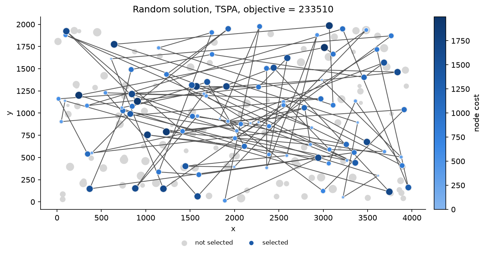
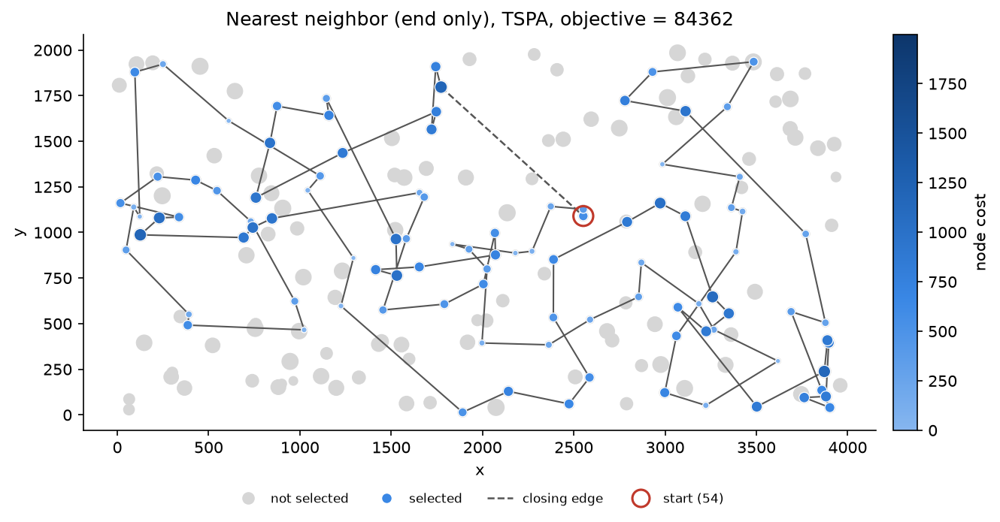
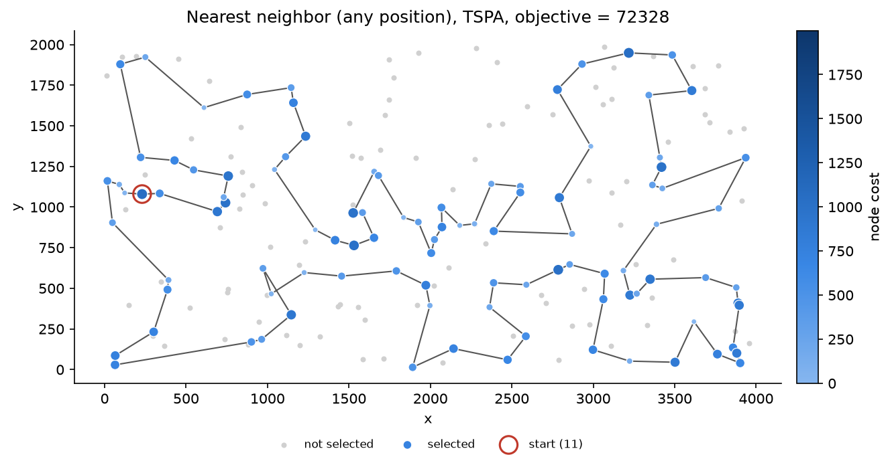
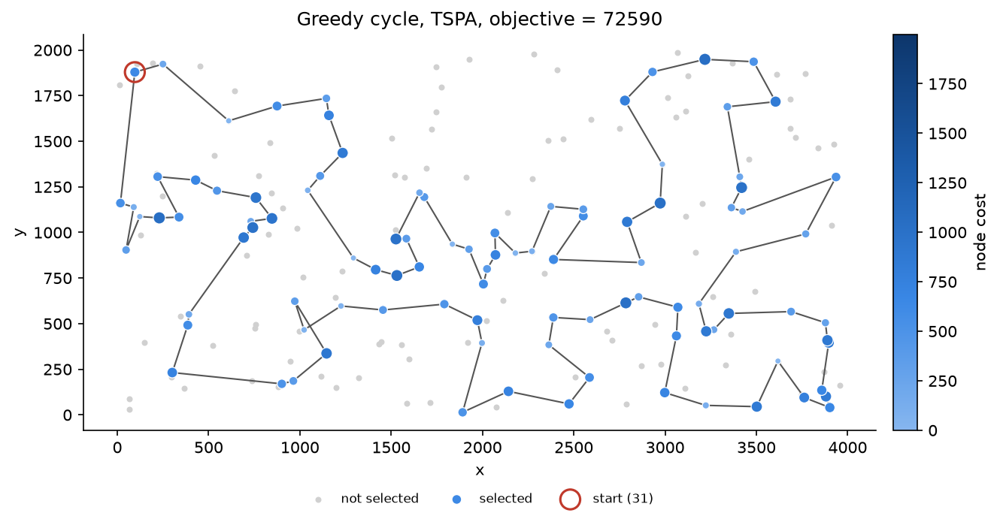
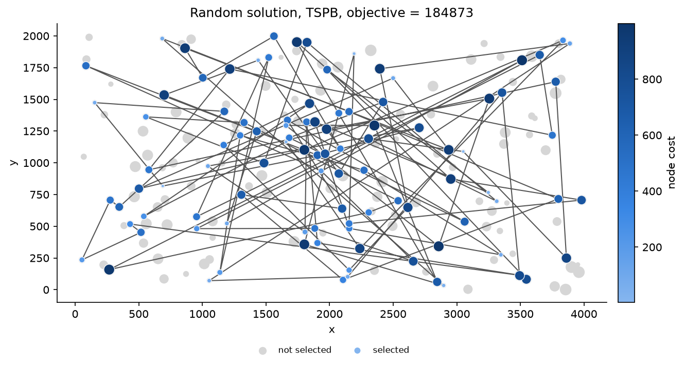
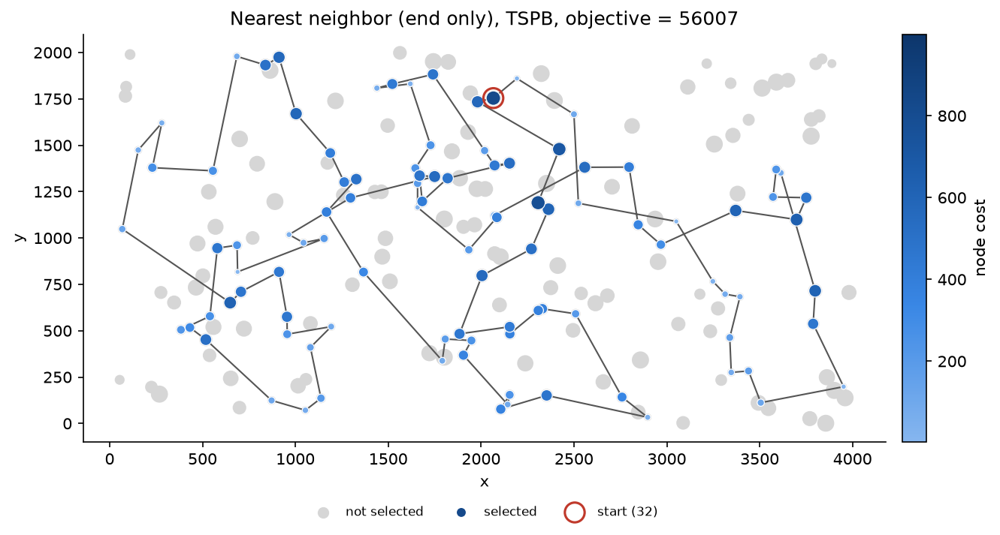
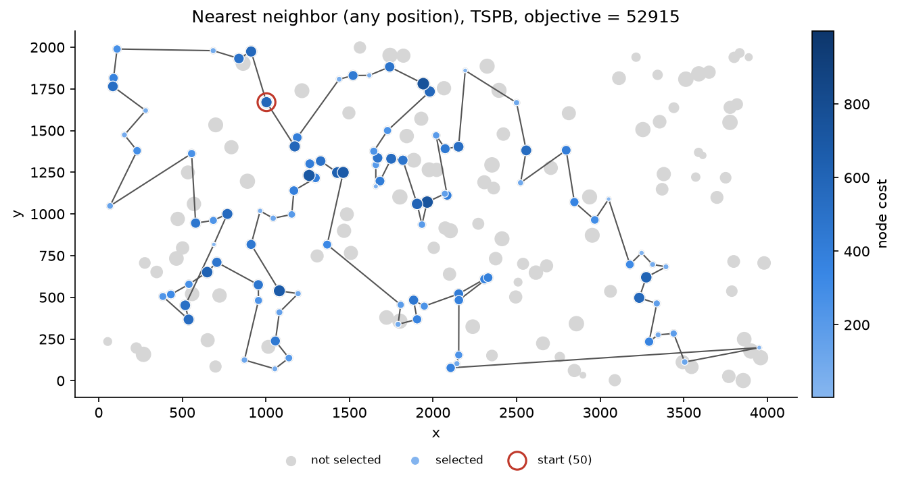
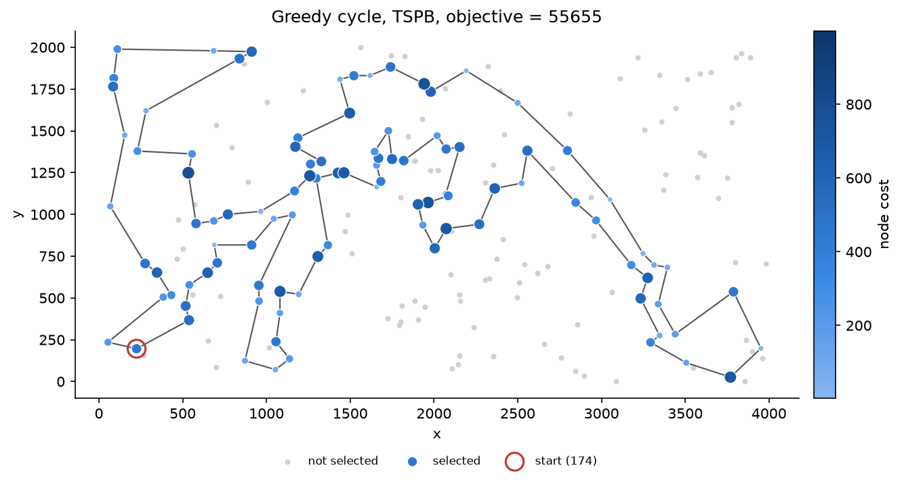

# Problem description

We are given a set of nodes, each with x and y coordinates and a cost. The task is to select exactly half of the nodes (rounded up if the number of nodes is odd) and to form a Hamiltonian cycle through the selected nodes. The goal is to minimize the length of the cycle plus the total cost of the selected nodes. Distances are Euclidean, rounded mathematically to integers, computed in the same way as in the solution checker: `(int)(sqrt(dx*dx + dy*dy) + 0.5)`.

Both instances, TSPA and TSPB, have 200 nodes, so every solution contains 100 nodes. The distance matrix is computed right after reading an instance and the coordinates are then discarded, so the optimization methods only see the distance matrix and the node costs.

# Implemented methods

In all greedy methods the node to add is chosen by the change of the full objective, that is the added distance plus the cost of the new node, not by distance alone. If two candidates give the same change, the first one found is taken: nodes are scanned in increasing order of index and positions from the beginning of the path or cycle. In the following, `n` is the number of nodes, `k = ceil(n/2)`, `d` is the distance matrix, `c` is the vector of costs and `s` is the starting node.

## Random solution

```
k = ceil(n / 2)
P = random permutation of nodes 0..n-1
return the first k nodes of P, in this order, as a cycle
```

The generator is `std::mt19937` with seed `42 + i` for the i-th run, so each of the 200 random solutions can be reproduced on its own. The permutation is made with `std::shuffle`, whose exact output depends on the standard library, so the random results are reproducible with Apple clang (libc++) but would differ with GCC.

## Nearest neighbor, adding only at the end of the path

```
path = [s]
while |path| < k:
    last = last node of path
    j = unselected node minimizing d[last][j] + c[j]
    append j to path
close the path with the edge (last node, s)
```

## Nearest neighbor, adding at any position

```
path = [s]
while |path| < k:
    for every unselected node j and every position p = 0..|path|:
        if p = 0:           delta = d[j][path[0]] + c[j]
        else if p = |path|: delta = d[path[p-1]][j] + c[j]
        else:
            a = path[p-1], b = path[p]
            delta = d[a][j] + d[j][b] - d[a][b] + c[j]
    insert the node j at the position p with the smallest delta
close the path with the edge (last node, first node)
```

In both nearest neighbor variants the solution is built as an open path. Adding a node at the beginning or at the end costs only one edge, and the closing edge is added after all `k` nodes are selected. The objective of the final solution always includes the closing edge.

## Greedy cycle

```
j = unselected node minimizing 2 * d[s][j] + c[j]
cycle = [s, j]
while |cycle| < k:
    for every unselected node j and every edge (a, b) of the cycle:
        delta = d[a][j] + d[j][b] - d[a][b] + c[j]
    insert the node j with the smallest delta between a and b
return cycle
```

The second node is chosen with the doubled distance, because a cycle of two nodes uses the edge between them twice.

## Implementation notes

All methods have the same interface: they take the instance and the starting node and return the solution together with the objective value, which they update incrementally from the deltas. After every run the solution is validated: it must contain exactly `k` nodes, all indices must be in range, there can be no duplicates, and the objective recomputed from scratch must be equal to the value returned by the method. All 1600 solutions passed these checks.

The nearest neighbor with insertion at any position and the greedy cycle both check every unselected node at every position in each step, so one run takes $O(nk^2)$ time. The end-only variant needs $O(nk)$. The program was compiled with Apple clang 17 with `-O2` and run on an Apple M2 Pro.

# Results

Each greedy method was started from every node (200 runs per instance), and 200 random solutions were generated.

Table: Objective value, average (min - max) over 200 runs.

| Method | TSPA | TSPB |
|---|---|---|
| Random solution | 261657.6 (233510 - 292900) | 206274.9 (184873 - 230807) |
| Nearest neighbor (end only) | 87476.6 (84362 - 90075) | 59397.3 (56007 - 63166) |
| Nearest neighbor (any position) | 74347.0 (72328 - 77022) | 59475.5 (52915 - 66164) |
| Greedy cycle | 73793.4 (72590 - 75281) | 59649.9 (55655 - 63734) |

Table: Average time of one run in milliseconds.

| Method | TSPA | TSPB |
|---|---|---|
| Random solution | 0.005 | 0.005 |
| Nearest neighbor (end only) | 0.018 | 0.018 |
| Nearest neighbor (any position) | 0.730 | 0.732 |
| Greedy cycle | 0.625 | 0.647 |

# Visualization of the best solutions

In the plots, the size of every node shows its cost, so larger points are more expensive. Grey points are nodes that were not selected, and selected nodes are also coloured by cost (darker means more expensive). The size and colour scales are the same for all methods on one instance. The red circle marks the starting node of the best run.

{width=95%}

{width=95%}

{width=95%}

{width=95%}

{width=95%}

{width=95%}

{width=95%}

{width=95%}

# Best solutions

Node indices start from 0. The cycle closes from the last node back to the first one.

Random solution, TSPA, objective 233510:

148, 97, 174, 31, 103, 173, 143, 34, 84, 167, 195, 184, 29, 135, 27, 134, 136, 58, 62, 6, 49, 163, 26, 101, 140, 89, 177, 16, 44, 156, 131, 55, 80, 183, 36, 8, 176, 191, 179, 28, 199, 68, 107, 57, 93, 137, 197, 85, 157, 115, 196, 189, 98, 113, 110, 83, 159, 164, 116, 95, 194, 117, 130, 150, 9, 22, 152, 142, 168, 149, 122, 15, 51, 32, 35, 43, 190, 123, 38, 112, 59, 46, 144, 37, 182, 4, 175, 90, 133, 41, 23, 0, 114, 39, 67, 53, 54, 146, 3, 151

Nearest neighbor (end only), TSPA, objective 84362:

54, 9, 33, 36, 177, 67, 144, 53, 135, 58, 134, 176, 174, 106, 89, 107, 57, 182, 151, 93, 50, 3, 1, 164, 178, 29, 136, 186, 184, 47, 159, 130, 153, 78, 88, 193, 170, 146, 75, 64, 150, 42, 113, 43, 85, 142, 8, 131, 84, 158, 192, 181, 114, 141, 180, 132, 76, 80, 48, 31, 63, 149, 168, 97, 127, 187, 30, 123, 152, 108, 60, 116, 49, 11, 119, 160, 83, 90, 51, 16, 35, 87, 45, 140, 52, 179, 185, 28, 102, 156, 157, 71, 91, 38, 100, 4, 112, 139, 115, 5

Nearest neighbor (any position), TSPA, objective 72328:

104, 129, 69, 127, 97, 168, 116, 149, 63, 11, 49, 160, 83, 123, 100, 152, 108, 60, 31, 48, 80, 91, 157, 71, 4, 76, 132, 180, 28, 102, 185, 35, 156, 51, 16, 67, 144, 140, 53, 179, 52, 177, 36, 33, 9, 54, 131, 174, 8, 164, 186, 136, 163, 29, 101, 178, 1, 169, 3, 50, 147, 47, 93, 106, 42, 89, 113, 130, 159, 146, 170, 153, 193, 78, 88, 107, 64, 57, 182, 151, 150, 176, 72, 134, 84, 58, 158, 192, 181, 114, 135, 73, 45, 87, 141, 187, 30, 189, 2, 171

Greedy cycle, TSPA, objective 72590:

31, 116, 149, 168, 63, 11, 49, 60, 108, 152, 100, 90, 123, 83, 160, 97, 127, 69, 171, 2, 189, 30, 187, 141, 87, 45, 73, 135, 114, 181, 192, 158, 58, 84, 134, 72, 176, 150, 151, 182, 57, 64, 107, 88, 78, 193, 153, 170, 146, 159, 130, 113, 89, 42, 106, 93, 47, 147, 50, 3, 169, 1, 178, 101, 29, 163, 136, 186, 164, 142, 8, 174, 131, 54, 9, 33, 36, 177, 52, 179, 53, 140, 144, 67, 16, 51, 156, 35, 185, 102, 28, 180, 132, 76, 4, 71, 157, 91, 80, 48

Random solution, TSPB, objective 184873:

89, 46, 101, 171, 116, 86, 56, 82, 33, 25, 136, 150, 160, 79, 111, 121, 123, 189, 40, 199, 108, 34, 66, 183, 158, 124, 164, 129, 75, 54, 68, 139, 177, 195, 148, 169, 71, 73, 163, 151, 13, 122, 144, 140, 59, 117, 51, 2, 29, 197, 1, 178, 103, 191, 28, 170, 173, 155, 198, 45, 21, 27, 20, 181, 95, 127, 156, 9, 188, 18, 87, 134, 105, 83, 119, 179, 38, 92, 6, 69, 126, 94, 128, 19, 57, 159, 7, 50, 58, 3, 109, 12, 186, 172, 0, 39, 16, 106, 131, 152

Nearest neighbor (end only), TSPB, objective 56007:

32, 89, 57, 76, 54, 127, 129, 90, 153, 20, 14, 2, 110, 118, 56, 114, 196, 10, 148, 143, 78, 192, 162, 104, 185, 184, 3, 151, 69, 172, 133, 120, 96, 121, 198, 48, 72, 46, 86, 117, 160, 136, 8, 21, 154, 140, 47, 170, 125, 177, 6, 132, 29, 197, 175, 134, 45, 60, 40, 71, 155, 97, 115, 180, 65, 28, 149, 145, 158, 116, 147, 42, 50, 130, 30, 183, 38, 64, 85, 59, 167, 51, 87, 179, 82, 88, 171, 99, 67, 24, 34, 181, 152, 73, 98, 27, 135, 75, 79, 156

Nearest neighbor (any position), TSPB, objective 52915:

110, 2, 14, 20, 74, 153, 182, 52, 90, 129, 127, 80, 54, 192, 162, 104, 76, 185, 57, 89, 86, 46, 72, 3, 184, 173, 151, 122, 117, 8, 160, 69, 172, 136, 133, 120, 156, 43, 48, 96, 198, 121, 130, 191, 50, 42, 147, 116, 37, 146, 13, 149, 28, 145, 65, 158, 177, 125, 26, 170, 197, 36, 132, 29, 6, 180, 115, 155, 71, 175, 134, 45, 157, 60, 40, 141, 97, 154, 140, 47, 38, 21, 176, 30, 183, 189, 168, 64, 59, 85, 51, 73, 167, 152, 34, 24, 181, 179, 87, 82

Greedy cycle, TSPB, objective 55655:

174, 36, 197, 6, 180, 115, 170, 97, 140, 47, 155, 71, 175, 134, 45, 157, 60, 141, 40, 33, 64, 21, 189, 168, 69, 160, 172, 136, 133, 120, 8, 117, 72, 46, 86, 184, 3, 173, 122, 151, 98, 111, 27, 135, 76, 185, 162, 192, 80, 52, 182, 20, 74, 2, 93, 110, 118, 14, 153, 90, 129, 127, 54, 104, 57, 89, 156, 43, 48, 96, 198, 121, 63, 130, 191, 183, 30, 176, 38, 154, 26, 125, 177, 138, 158, 145, 149, 147, 42, 116, 37, 146, 13, 28, 65, 178, 103, 29, 132, 1

# Solution checker

Every solution was validated in the program as described above. The checker itself was used to test the objective function: the example solutions already entered in the checker give 253566 for TSPA and 200088 for TSPB, and our implementation returns the same values (this is one of the unit tests).

The best solutions listed above were also pasted into column F of the solution checker, and for all eight of them the checker gives the same objective values as in the table.

# Source code

<https://github.com/ZiarnoM/evolutionary-computation/tree/assignment-1>

The common code is in `src/core` (instance, distance matrix, objective, validation) and every method has its own file in `src/methods`. Plots and tables are made by the Python scripts in `scripts`.

# Conclusions

All greedy methods are much better than random selection. The average random solution is about 3.5 times worse than the average greedy cycle solution on both instances (261658 against 73793 on TSPA, 206275 against 59650 on TSPB). A random solution takes nodes regardless of their cost and connects them with long edges: the cycle length of the best random solution on TSPA is 145354, which alone is about twice the whole objective of a greedy solution.

On TSPA the order of the methods is clear. Greedy cycle has the best average (73793) and the smallest spread between starting nodes (standard deviation 529). The nearest neighbor with insertion at any position is close (average 74347) and found the single best solution, 72328. The end-only nearest neighbor is about 18% worse on average (87477). It can only extend one end of the path, so when the area around the last node is used up it has to jump far, and these jumps are visible as long edges in its plot. Greedy cycle gave a better result than the any-position nearest neighbor from 144 of the 200 starting nodes.

On TSPB the three greedy methods are almost equal on average (59397, 59476 and 59650), and the simplest end-only variant even has the lowest average. The any-position nearest neighbor found both the best solution on this instance (52915) and the worst greedy one (66164). We think the reason is the open path. The closing edge is added only at the end, so nothing keeps the two ends of the path close to each other. On TSPB the closing edge in solutions of this method is 2031 long on average, compared to 1651 for the end-only variant, and in the plot of its best solution the closing edge goes across the bottom of the map. The same effect is present on TSPA, only weaker (1576 against 1452), and the worst TSPA solution of this method (77022) has the longest closing edge of all its 200 runs, 3392. Greedy cycle does not have this problem, because every insertion is evaluated on a closed cycle.

The differences between the instances come mostly from the node costs. The node layout and distances are on a similar scale, but TSPA costs go up to 1997 (mean 971) and TSPB costs only up to 999 (mean 519). On TSPA the costs dominate: the best greedy solutions contain 87 to 92 of the 100 cheapest nodes, and in the plots almost all large grey points are left out, even those lying next to the cycle. On TSPB a cheap node is less important compared to the distance, the best solutions contain only 73 to 85 of the 100 cheapest nodes, and the result depends more on the starting node. The standard deviation over starting nodes is 2098 to 2812 on TSPB and 529 to 1332 on TSPA.

The running times agree with the complexity. One run takes about 0.02 ms for the end-only nearest neighbor and 0.6 to 0.7 ms for the other two methods. Even the slowest method needs less than 0.2 s for all 200 starting nodes, so it makes sense to start from every node, especially since on TSPB the best and the worst start of the same method differ by up to 13249.
