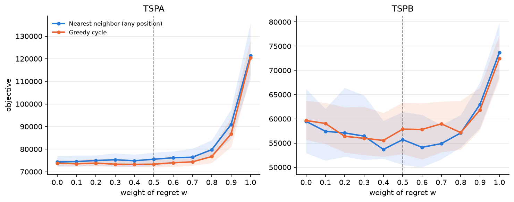
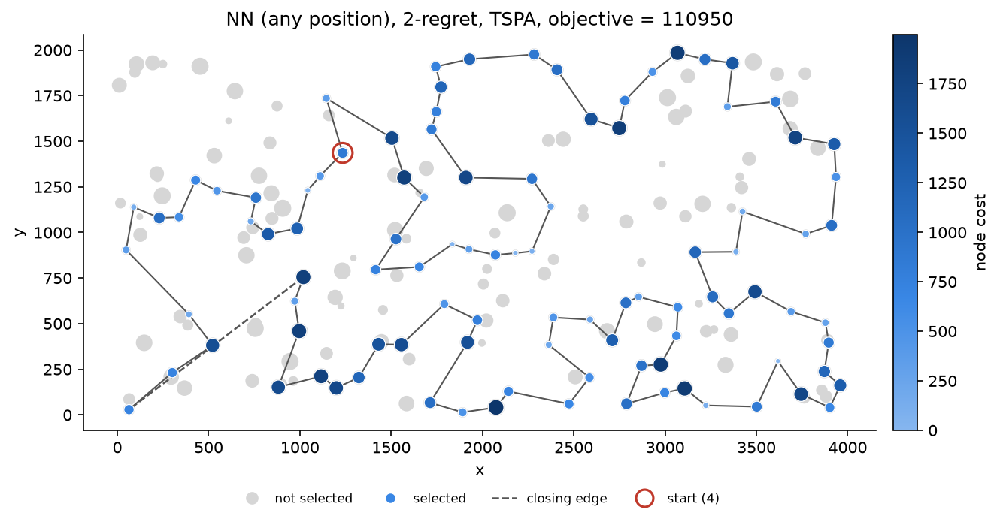
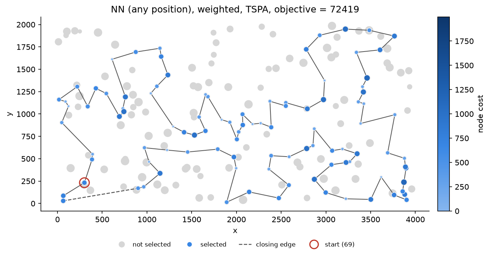
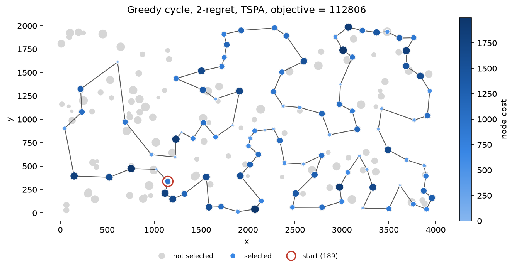
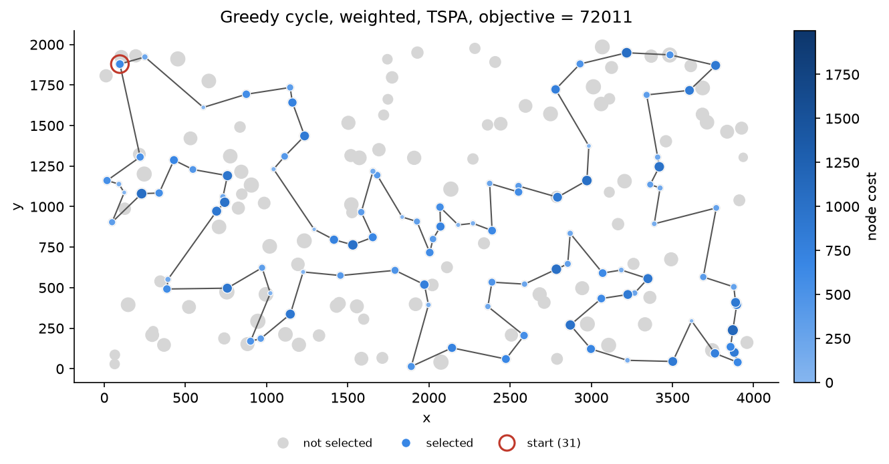
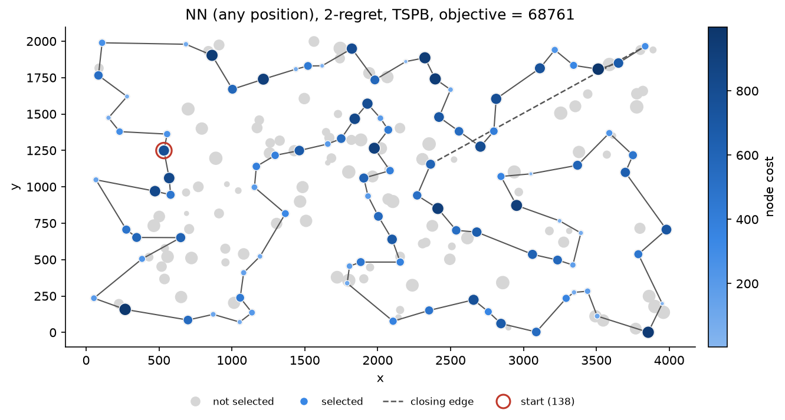
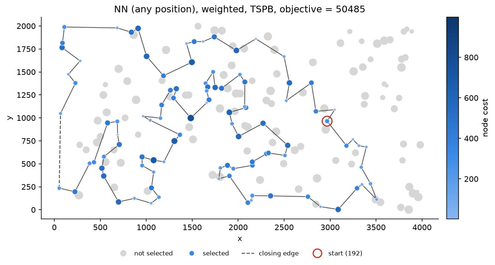
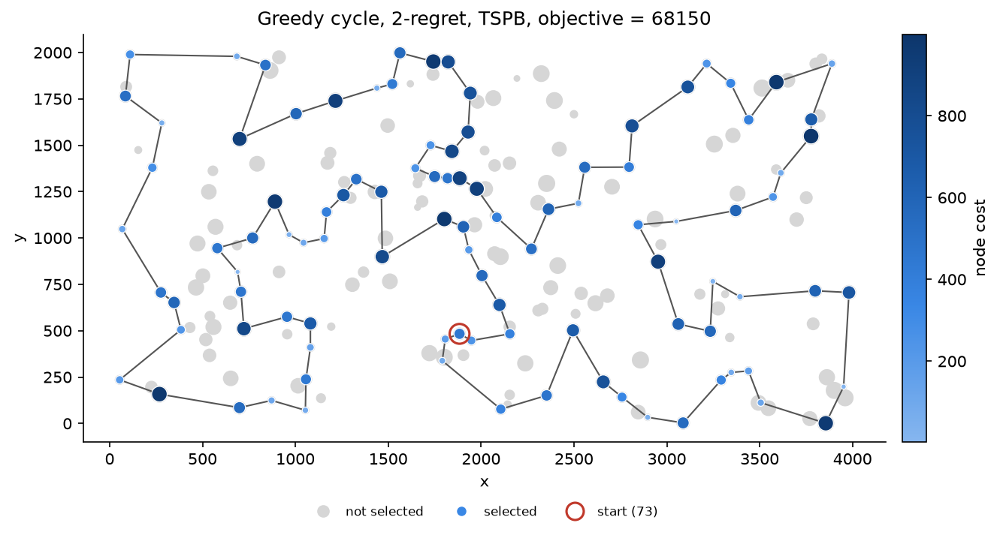
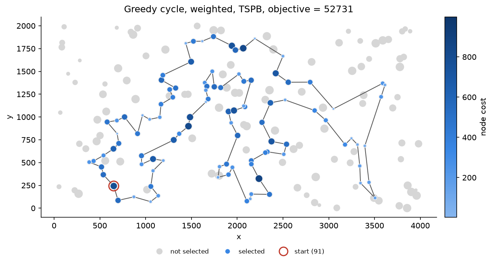

# Problem description

We are given a set of nodes, each with x and y coordinates and a cost. The task is to select exactly half of the nodes (rounded up if the number of nodes is odd) and to form a Hamiltonian cycle through the selected nodes. The goal is to minimize the length of the cycle plus the total cost of the selected nodes. Distances are Euclidean, rounded mathematically to integers, computed in the same way as in the solution checker: `(int)(sqrt(dx*dx + dy*dy) + 0.5)`.

Both instances, TSPA and TSPB, have 200 nodes, so every solution contains 100 nodes. The distance matrix is computed right after reading an instance and the coordinates are then discarded, so the optimization methods only see the distance matrix and the node costs.

# Implemented methods

This assignment adds two criteria for choosing the next node, 2-regret and a weighted sum of 2-regret and the best change of the objective, and each of them is used with two kinds of insertion: the nearest neighbor with insertion at any position of a path and the greedy cycle. The pseudocode of the methods from the previous assignment (random solution, both nearest neighbor variants and greedy cycle) is in the Assignment 1 report and these methods were not changed.

In the following, `n` is the number of nodes, `k = ceil(n/2)`, `d` is the distance matrix, `c` is the vector of costs and `s` is the starting node. The change of the objective after inserting node `j` at a given position, `delta`, is computed in the same way as before. For the greedy cycle it is `d[a][j] + d[j][b] - d[a][b] + c[j]` for an edge (a, b) of the cycle. For the nearest neighbor the solution is an open path, so `j` can also be added before the first or after the last node, which costs one edge plus `c[j]`, and the closing edge is added after `k` nodes are selected.

## Greedy 2-regret and weighted criterion

Both criteria are implemented by one procedure with a weight `w` of the regret:

```
sol = [s]
while |sol| < k:
    for every unselected node j:
        compute delta of inserting j at every position of sol
        best1(j) = the smallest delta, best2(j) = the second smallest delta
        regret(j) = best2(j) - best1(j)
        score(j) = w * regret(j) - (1 - w) * best1(j)
    j = node with the highest score
    insert j at the position of best1(j)
if sol is a path: close it with the edge (last node, first node)
return sol
```

The greedy 2-regret heuristic uses `w = 1`, so the node with the largest regret is inserted, that is the node which would lose the most if its best position was taken by another node. The weighted criterion uses equal weights, `w = 0.5`, which gives the same order of nodes as `regret(j) - best1(j)`. With `w = 0` the procedure is the plain greedy choice from Assignment 1, and we checked in a unit test that for every starting node it gives the same solutions as the nearest neighbor (any position) and the greedy cycle.

The cost `c[j]` is added to every delta of node `j`, so it cancels out in the regret. The pure 2-regret heuristic therefore does not use the node costs at all, apart from breaking ties.

If two nodes have the same score, the one with the smaller `best1` is taken, and if this is also equal, the node with the lower index. This rule is needed at the start of the construction. A cycle with one node has only one position, so the regret is set to 0, and a cycle with two nodes has two edges between the same pair of nodes, so both positions give the same delta. In a path with one node, inserting before or after it also costs the same. In these steps every node has regret 0, and the next node is chosen by the smallest delta, the same as in the plain methods.

## Implementation notes

All methods have the same interface: they take the instance and the starting node and return the solution together with the objective value, which they update incrementally from the deltas. After every run the solution is validated: it must contain exactly `k` nodes, all indices must be in range, there can be no duplicates, and the objective recomputed from scratch must be equal to the value returned by the method. All 3200 solutions of the main experiment (8 methods, 2 instances, 200 runs) and all solutions of the run with different weights passed these checks.

In every step all unselected nodes are checked at all positions, as in the greedy cycle, so one run still takes $O(nk^2)$ time. The regret only needs the two smallest deltas of each node, which are kept during the same loop. The program was compiled with Apple clang 17 with `-O2` and run on an Apple M2 Pro.

# Results

Each method except the random one was started from every node (200 runs per instance), and 200 random solutions were generated. The first four rows are the methods from Assignment 1.

Table: Objective value, average (min - max) over 200 runs.

| Method | TSPA | TSPB |
|---|---|---|
| Random solution | 261657.6 (233510 - 292900) | 206274.9 (184873 - 230807) |
| Nearest neighbor (end only) | 87476.6 (84362 - 90075) | 59397.3 (56007 - 63166) |
| Nearest neighbor (any position) | 74347.0 (72328 - 77022) | 59475.5 (52915 - 66164) |
| Greedy cycle | 73793.4 (72590 - 75281) | 59649.9 (55655 - 63734) |
| NN (any position), 2-regret | 121360.3 (110950 - 135771) | 73649.8 (68761 - 79756) |
| NN (any position), weighted | 75549.4 (72419 - 78504) | 55698.9 (50485 - 61406) |
| Greedy cycle, 2-regret | 120378.8 (112806 - 128089) | 72484.8 (68150 - 77274) |
| Greedy cycle, weighted | 73353.5 (72011 - 75532) | 57863.3 (52731 - 63370) |

Table: Average time of one run in milliseconds.

| Method | TSPA | TSPB |
|---|---|---|
| Random solution | 0.005 | 0.005 |
| Nearest neighbor (end only) | 0.019 | 0.018 |
| Nearest neighbor (any position) | 0.715 | 0.722 |
| Greedy cycle | 0.621 | 0.628 |
| NN (any position), 2-regret | 0.801 | 0.801 |
| NN (any position), weighted | 0.797 | 0.798 |
| Greedy cycle, 2-regret | 0.857 | 0.857 |
| Greedy cycle, weighted | 0.859 | 0.852 |

## Other weights

We also ran both kinds of insertion with `w` from 0 to 1 in steps of 0.1, again from all 200 starting nodes. The value `w = 0` is the plain greedy method and `w = 1` is the pure 2-regret.

Table: Average objective over 200 runs for different weights of the regret.

| w | NN any, TSPA | Greedy cycle, TSPA | NN any, TSPB | Greedy cycle, TSPB |
|---|---|---|---|---|
| 0.0 | 74347.0 | 73793.4 | 59475.5 | 59649.9 |
| 0.1 | 74494.4 | 73522.4 | 57429.6 | 59041.2 |
| 0.2 | 74982.3 | 73829.5 | 57085.5 | 56385.1 |
| 0.3 | 75303.8 | 73344.1 | 56435.3 | 55982.4 |
| 0.4 | 74872.4 | 73277.4 | 53690.8 | 55548.3 |
| 0.5 | 75549.4 | 73353.5 | 55698.9 | 57863.3 |
| 0.6 | 76189.1 | 73980.1 | 54127.3 | 57808.9 |
| 0.7 | 76454.1 | 74378.2 | 54878.5 | 58969.5 |
| 0.8 | 79776.5 | 76747.1 | 57076.4 | 57162.5 |
| 0.9 | 90938.4 | 86722.2 | 62982.1 | 61813.7 |
| 1.0 | 121360.3 | 120378.8 | 73649.8 | 72484.8 |

{width=100%}

# Visualization of the best solutions

The plots show the best solutions of the four new methods, the plots for the methods from Assignment 1 are in the previous report. The size of every node shows its cost, so larger points are more expensive. Grey points are nodes that were not selected, and selected nodes are also coloured by cost (darker means more expensive). The size and colour scales are the same for all methods on one instance. In the nearest neighbor plots the closing edge, added after the path is complete, is drawn as a dashed line. The red circle marks the starting node of the best run.

{width=95%}

{width=95%}

{width=95%}

{width=95%}

{width=95%}

{width=95%}

{width=95%}

{width=95%}

# Best solutions

Node indices start from 0. The cycle closes from the last node back to the first one. The best solutions of the methods from Assignment 1 are the same as in the previous report.

NN (any position), 2-regret, TSPA, objective 110950:

104, 69, 120, 97, 168, 149, 11, 49, 108, 152, 100, 123, 148, 162, 132, 76, 4, 157, 18, 173, 16, 156, 28, 185, 67, 144, 179, 177, 36, 33, 143, 190, 139, 112, 5, 115, 175, 39, 154, 34, 109, 186, 136, 197, 163, 19, 178, 101, 155, 21, 147, 37, 47, 50, 93, 81, 43, 113, 117, 130, 159, 170, 75, 26, 78, 122, 107, 64, 57, 105, 182, 111, 138, 165, 151, 150, 176, 72, 65, 134, 84, 58, 158, 192, 181, 118, 114, 25, 121, 73, 45, 70, 96, 10, 183, 166, 32, 40, 30, 23

NN (any position), weighted, TSPA, objective 72419:

171, 2, 189, 187, 30, 141, 87, 45, 73, 135, 114, 181, 192, 158, 58, 84, 134, 72, 176, 174, 150, 106, 113, 89, 42, 151, 138, 182, 57, 64, 107, 88, 78, 193, 153, 75, 170, 146, 159, 130, 47, 93, 50, 3, 169, 1, 59, 178, 101, 55, 29, 163, 136, 186, 164, 142, 8, 9, 54, 33, 131, 36, 177, 52, 179, 53, 140, 144, 67, 16, 51, 35, 185, 102, 28, 180, 132, 76, 4, 71, 157, 91, 80, 100, 123, 83, 160, 152, 108, 49, 60, 116, 149, 63, 168, 97, 127, 69, 129, 104

Greedy cycle, 2-regret, TSPA, objective 112806:

189, 166, 183, 10, 70, 22, 25, 114, 118, 181, 121, 61, 41, 140, 53, 179, 177, 36, 99, 84, 134, 72, 65, 20, 192, 111, 182, 165, 151, 106, 89, 124, 57, 64, 107, 88, 78, 26, 75, 170, 159, 130, 117, 93, 50, 47, 37, 147, 6, 46, 86, 55, 17, 29, 19, 163, 197, 136, 195, 184, 164, 142, 85, 81, 174, 194, 9, 33, 143, 62, 34, 154, 39, 175, 115, 5, 112, 139, 18, 4, 196, 51, 190, 67, 185, 156, 28, 180, 191, 141, 30, 160, 80, 82, 11, 168, 188, 120, 125, 187

Greedy cycle, weighted, TSPA, objective 72011:

31, 60, 116, 149, 63, 168, 11, 49, 108, 152, 100, 123, 83, 160, 97, 127, 161, 30, 187, 171, 2, 189, 141, 87, 45, 73, 135, 114, 181, 192, 158, 58, 84, 134, 72, 176, 174, 150, 106, 113, 89, 42, 151, 138, 182, 57, 64, 107, 88, 78, 193, 153, 75, 170, 146, 159, 130, 47, 93, 50, 3, 169, 1, 178, 101, 55, 29, 163, 136, 186, 164, 142, 8, 9, 54, 33, 131, 36, 177, 52, 179, 53, 140, 144, 67, 16, 51, 35, 185, 102, 28, 180, 132, 76, 4, 71, 157, 91, 80, 48

NN (any position), 2-regret, TSPB, objective 68761:

94, 169, 199, 70, 190, 194, 77, 104, 144, 185, 79, 57, 83, 44, 89, 156, 164, 96, 198, 121, 195, 50, 7, 116, 37, 13, 149, 28, 145, 158, 138, 55, 177, 53, 65, 178, 103, 180, 132, 1, 108, 62, 175, 134, 45, 157, 60, 40, 64, 47, 38, 21, 168, 172, 8, 92, 166, 72, 46, 109, 3, 122, 151, 98, 25, 181, 73, 59, 85, 82, 88, 163, 99, 39, 17, 74, 20, 14, 2, 23, 110, 118, 131, 143, 148, 196, 78, 54, 162, 106, 127, 90, 153, 182, 150, 84, 66, 35, 27, 135

NN (any position), weighted, TSPB, objective 50485:

65, 145, 28, 149, 13, 146, 37, 116, 147, 42, 50, 130, 63, 121, 198, 96, 48, 156, 89, 57, 185, 76, 104, 162, 54, 192, 80, 127, 129, 90, 153, 14, 2, 20, 74, 17, 171, 99, 88, 179, 87, 82, 51, 85, 59, 73, 167, 181, 152, 34, 24, 67, 66, 27, 98, 151, 122, 3, 184, 46, 72, 117, 8, 120, 133, 136, 172, 160, 69, 124, 21, 183, 30, 38, 47, 154, 140, 64, 33, 40, 141, 155, 71, 60, 157, 45, 134, 175, 62, 36, 197, 6, 115, 170, 125, 177, 29, 132, 174, 1

Greedy cycle, 2-regret, TSPB, objective 68150:

73, 167, 181, 25, 98, 151, 122, 128, 4, 168, 183, 176, 38, 47, 140, 154, 161, 26, 177, 170, 115, 113, 155, 141, 60, 157, 134, 175, 62, 108, 1, 132, 103, 178, 65, 145, 149, 13, 37, 116, 147, 123, 50, 195, 121, 198, 58, 16, 164, 43, 166, 92, 120, 133, 8, 117, 95, 109, 3, 27, 135, 76, 185, 104, 77, 194, 190, 70, 187, 165, 105, 139, 193, 114, 10, 78, 54, 162, 106, 150, 182, 127, 90, 56, 131, 110, 23, 2, 14, 20, 74, 17, 171, 99, 163, 31, 88, 82, 85, 59

Greedy cycle, weighted, TSPB, objective 52731:

91, 36, 197, 132, 29, 6, 180, 115, 170, 177, 125, 26, 97, 154, 140, 47, 38, 21, 30, 183, 191, 130, 63, 121, 198, 96, 48, 43, 156, 32, 89, 57, 79, 185, 104, 54, 196, 114, 10, 90, 14, 2, 20, 153, 129, 127, 80, 192, 162, 76, 135, 27, 11, 66, 67, 24, 34, 152, 181, 126, 88, 179, 87, 82, 167, 51, 85, 59, 73, 98, 151, 122, 173, 3, 184, 86, 46, 72, 117, 8, 120, 133, 136, 172, 160, 69, 124, 4, 64, 33, 155, 71, 141, 40, 60, 157, 45, 134, 175, 62

# Solution checker

Every solution was validated in the program as described above, using the same objective function that was tested against the example solutions in the checker in Assignment 1.

The best solutions of all eight methods on both instances, including the methods from Assignment 1, were also pasted into column F of a copy of the solution checker (by a script, `scripts/checker.py`, which opens the copy in Numbers and reads the total from cell K2). For all sixteen solutions the checker gives the same objective values as in the table.

# Source code

<https://github.com/ZiarnoM/evolutionary-computation/tree/assignment-2>

Both new criteria are in `src/methods/regret.cpp`. The common code is in `src/core` and the experiment, including the run with different weights, is in `src/main.cpp`. Plots and tables are made by the Python scripts in `scripts`.

# Conclusions

The pure 2-regret heuristic is clearly worse than the plain greedy methods: its average is about 1.6 times higher on TSPA (121360 and 120379 against 74347 and 73793) and about 1.2 times higher on TSPB. The reason is that the node cost cancels out in the regret, so this criterion only looks at distances. The cycles it builds are not long, the best greedy cycle 2-regret solution on TSPA has a cycle length of 21429, while the plain greedy cycle has 21570. The difference is in the costs: the selected nodes cost 91377 against 51020, and only 51 of the 100 cheapest nodes are in the solution, compared to 90 for the plain greedy cycle. In the plots this is visible as many large dark points on the cycle. On TSPB the costs are about two times lower, so ignoring them hurts less, and that is why the gap is smaller there.

The weighted criterion with equal weights takes both the regret and the cost into account and gives the best results among the constructive methods so far. On TSPB the weighted nearest neighbor has the best average (55699) and the best single solution (50485). Its average is about 6% better than the plain nearest neighbor (59476, best 52915), and it gave a better result from 177 of the 200 starting nodes. The weighted greedy cycle improved the average from 59650 to 57863 and was better from 167 starting nodes. On TSPA the weighted greedy cycle has the best average (73354) and the best solution (72011), although the gain over the plain greedy cycle is small (0.6% on average), and it was better from 153 starting nodes. The regret part mostly shortens the cycle: the best weighted greedy cycle on TSPB has length 16365 against 19634 for the plain one, while the cost of the selected nodes is almost the same (36366 against 36021). On TSPA the length goes from 21570 to 20248.

The weighted nearest neighbor on TSPA is the only case where the regret did not help. Its average is 75549 against 74347, and it was better than the plain version only from 59 starting nodes. Its best solution has a shorter path (20127 against 21816), but more expensive nodes (52292 against 50512). We think this is because on TSPA the costs dominate the objective, and half of the weight now goes to the regret, which ignores the costs, so expensive nodes are accepted more easily. The greedy cycle does not lose in the same way, but we did not find a clear reason for this difference.

The run with other weights shows that the method is not very sensitive to `w` as long as it is not too high. For `w` up to 0.7 all averages stay within about 3% of the plain method on TSPA and below it on TSPB, and from 0.8 the results get quickly worse towards the pure regret. The best averages were obtained around `w = 0.4` (73277 for the greedy cycle on TSPA, 53691 and 55548 on TSPB), but the curves are not smooth, for example on TSPB the greedy cycle has 55548 at 0.4 and 57863 at 0.5, so the exact optimum depends on the starting nodes and we kept the equal weights in the main table.

The weighted methods have a larger spread between starting nodes. On TSPA the standard deviation of the greedy cycle goes from 529 to 910, and on TSPB from 2812 to 3530. The running time increased by 12 to 38% compared to the plain versions, to about 0.8 to 0.86 ms per run, because for every node the two best positions are kept and the score is computed, but the complexity stays the same and all 200 starts still take less than 0.2 s.
