# Problem description

We are given a set of nodes, each with x and y coordinates and a cost. The task is to select exactly half of the nodes (rounded up if the number of nodes is odd) and to form a Hamiltonian cycle through the selected nodes. The goal is to minimize the length of the cycle plus the total cost of the selected nodes. Distances are Euclidean, rounded mathematically to integers, computed in the same way as in the solution checker: `(int)(sqrt(dx*dx + dy*dy) + 0.5)`.

Both instances, TSPA and TSPB, have 200 nodes, so every solution contains 100 nodes. The distance matrix is computed right after reading an instance and the coordinates are then discarded, so the optimization methods only see the distance matrix and the node costs.

## Implemented Methods

Two local search strategies were implemented:

- **Steepest:** Evaluates the entire neighborhood and selects the best improving move.
- **Greedy:** Examines moves in randomized order and applies the first improving move, avoiding evaluation of the remaining candidates.

Two types of intra-route moves were used: 

- **Nodes exchange** (swapping two selected nodes). 
- **Edges exchange** (2-opt segment reversal).

Both are combined with inter-route moves, which exchange one selected node with one unselected node.

Two types of starting solutions were tested:

- **Random solutions**
- **Greedy solutions**, constructed using the best heuristic from previous assignments with a random starting node.

This gives eight configurations combining the two search strategies, two intra-route move types, and two starting solution types.

### Delta Calculation

Following formulas were used to calculate delatas:

**1. Nodes exchange (intra-route)**

`Delta = new edge costs - old edge costs`

**2. Edges exchange (2-opt)**

`Delta = d(a,c) + d(b,d) - d(a,b) - d(c,d)`

**3. Inter-route exchange**

`Delta = d(prev,x) + d(x,next) - d(prev,v) - d(v,next) + c(x) - c(v)`

A move is accepted if `Delta < 0`.

### Pseudocode
Following procedure was used:

```
LOCAL_SEARCH(instance, start, search_type, intra_type, starting_type):

    if starting_type == GREEDY:
        Generate solutions using all construction heuristics
        Select the solution with the lowest objective value
    else:
        Generate a random feasible solution

    Mark all selected nodes as used

    repeat:
        Generate all possible moves:
            - Inter-route: exchange a selected node with an unselected node
            - Intra-route:
                - Nodes exchange, or
                - Edges exchange (2-opt)

        if search_type == GREEDY:
            Shuffle all moves into random order

        best_move = NONE

        for each move:
            if move is not valid:
                continue

            Calculate objective change (delta)

            if delta < 0:
                if search_type == GREEDY:
                    best_move = move
                    break
                else if move is better than best_move:
                    best_move = move

        if best_move == NONE:
            stop

        Apply best_move
        Update selected nodes and objective value

    return solution
```

Move types:
```
NODES EXCHANGE:
    Swap two selected nodes in the route.

EDGES EXCHANGE (2-opt):
    Select two non-adjacent edges.
    Remove them and reconnect the route
    by reversing the segment between them.

INTER-ROUTE EXCHANGE:
    Replace one selected node with one unselected node.
```

# Implementation notes

All methods have the same interface: they take the instance and the starting node and return the solution together with its objective value. The objective is updated incrementally using the delta of every accepted move.

A boolean array tracks which nodes are currently selected. This allows inter-route moves to be checked efficiently: a candidate can only be inserted if it is not already selected. After an accepted inter-route move, the array is updated to reflect the removed and inserted nodes.

For steepest descent, the complete neighborhood is evaluated in every iteration. For greedy descent, the move list is shuffled before evaluation, and the first improving move is accepted. The random generator is initialized using the starting node, so the move ordering is reproducible for a given start.

After every run the solution is validated: it must contain exactly `k` nodes, all indices must be in range, there can be no duplicates, and the objective recomputed from scratch must be equal to the value returned by the method.

The main experiment was run on both 200-node instances. Each local search method was tested from the starting nodes, with random starting solutions generated separately. The four construction methods from the previous assignment are included as baselines.

# Results

## Objective values

Table: Objective value, average (min - max) over 200 runs. The best average and the best solution on each instance are in bold.

| Method | TSPA | TSPB |
|---|---:|---:|
| Random solution | 261399.3 (232308 - 295992) | 206656.5 (182243 - 225227) |
| Nearest neighbor (end only) | 87476.6 (84362 - 90075) | 59397.3 (56007 - 63166) |
| Nearest neighbor (any position) | 74347.0 (72328 - 77022) | 59475.5 (52915 - 66164) |
| Greedy cycle | 73793.4 (72590 - 75281) | 59649.9 (55655 - 63734) |
| NN (any position), 2-regret | 121360.3 (110950 - 135771) | 73649.8 (68761 - 79756) |
| NN (any position), weighted | 75549.4 (72419 - 78504) | 55698.9 (50485 - 61406) |
| Greedy cycle, 2-regret | 120378.8 (112806 - 128089) | 72484.8 (68150 - 77274) |
| Greedy cycle, weighted | 73353.5 (72011 - 75532) | 57863.3 (52731 - 63370) |
| Steepest nodes, random start | 89804.2 (81798 - 98238) | 66004.1 (58601 - 74372) |
| Steepest nodes, greedy start | 72859.8 (**71955** - 74575) | 53822.2 (49978 - 60809) |
| Steepest edges, random start | 76282.2 (73550 - 79026) | **52524.8** (49789 - 55489) |
| Steepest edges, greedy start | **72751.6** (**71955** - 74575) | 53109.0 (**49346** - 59040) |
| Greedy nodes, random start | 88009.7 (81234 - 96055) | 63856.6 (57576 - 71226) |
| Greedy nodes, greedy start | 72858.7 (**71955** - 74575) | 53809.6 (49913 - 60809) |
| Greedy edges, random start | 76224.1 (74023 - 79349) | 52941.9 (50676 - 55402) |
| Greedy edges, greedy start | 72753.5 (**71955** - 74575) | 53161.2 (49683 - 59278) |

## Average running time

Table: Average time of one run in milliseconds.

| Method | TSPA | TSPB |
|---|---:|---:|
| Random solution | 0.006 | 0.017 |
| Nearest neighbor (end only) | 0.066 | 0.100 |
| Nearest neighbor (any position) | 1.206 | 1.514 |
| Greedy cycle | 1.741 | 1.836 |
| NN (any position), 2-regret | 0.801 | 0.801 |
| NN (any position), weighted | 0.797 | 0.798 |
| Greedy cycle, 2-regret | 0.857 | 0.857 |
| Greedy cycle, weighted | 0.859 | 0.852 |
| Steepest nodes, random start | 103.268 | 111.644 |
| Steepest nodes, greedy start | 20.220 | 28.881 |
| Steepest edges, random start | 37.648 | 39.550 |
| Steepest edges, greedy start | 19.225 | 22.970 |
| Greedy nodes, random start | 299.363 | 299.453 |
| Greedy nodes, greedy start | 26.378 | 38.782 |
| Greedy edges, random start | 287.531 | 371.313 |
| Greedy edges, greedy start | 21.624 | 43.406 |


# Visualization of the best solutions

The plots show the best solutions found by the local search methods on both instances. The plots for the construction methods from the previous assignment can be found in the previous report.

The size of every node shows its cost. Grey points are nodes that were not selected, while selected nodes are coloured by cost (darker means more expensive). The size and colour scales are the same for all methods on one instance. The red circle marks the starting node of the best run.


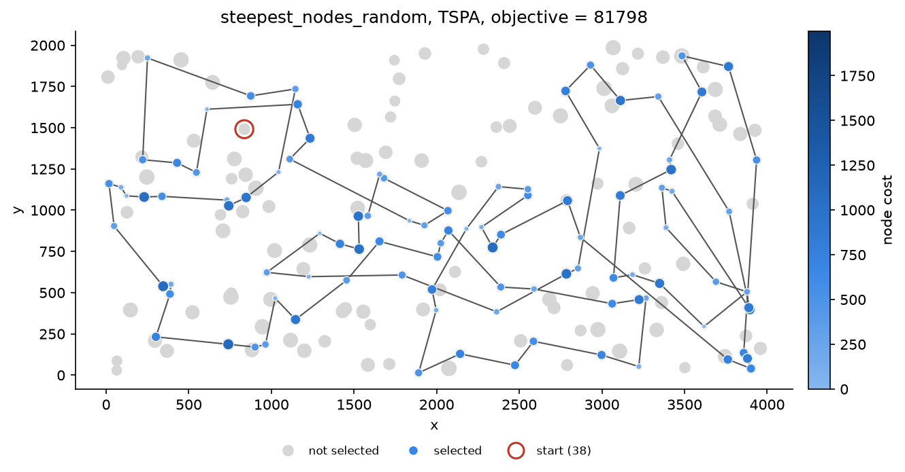{width=95%}

{width=95%}

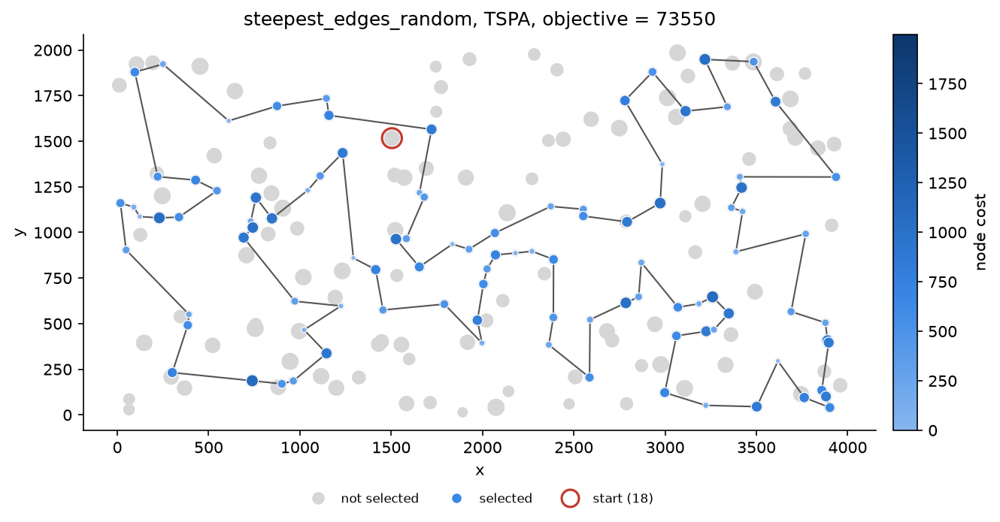{width=95%}

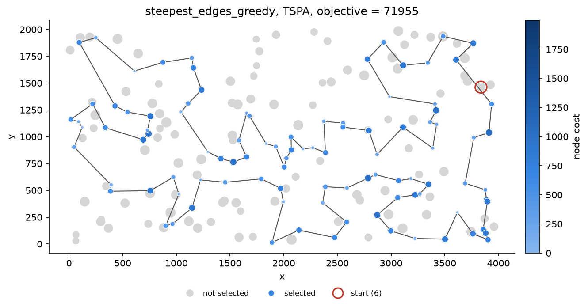{width=95%}

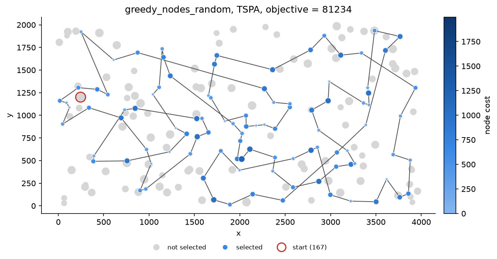{width=95%}

{width=95%}

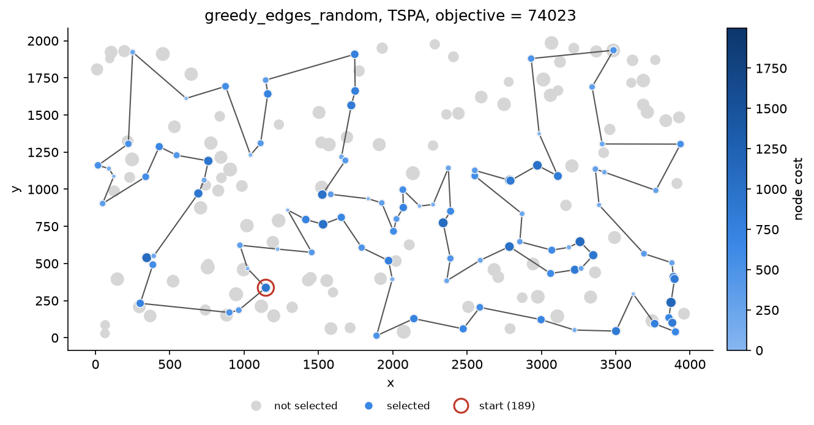{width=95%}

{width=95%}

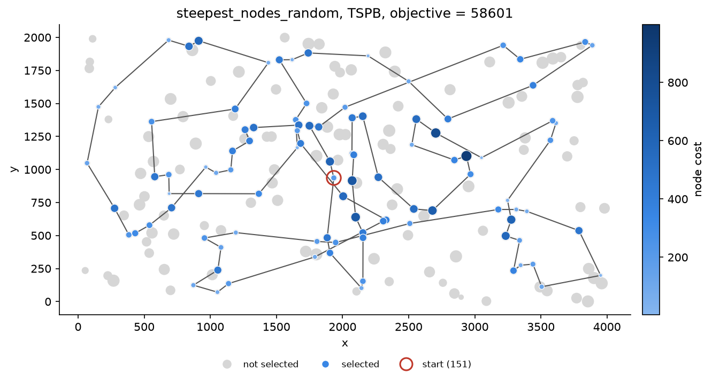{width=95%}

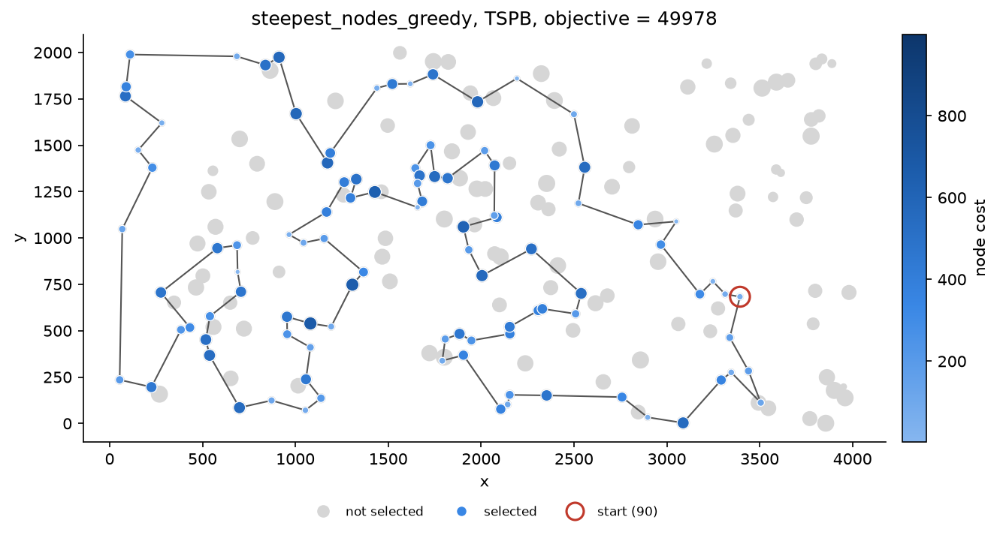{width=95%}

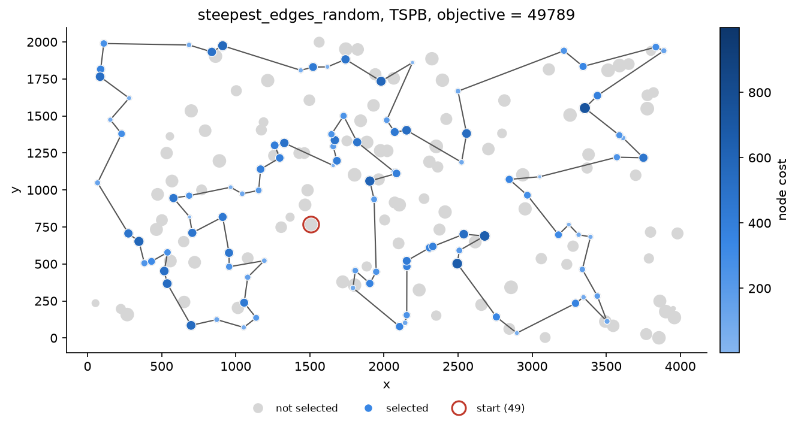{width=95%}

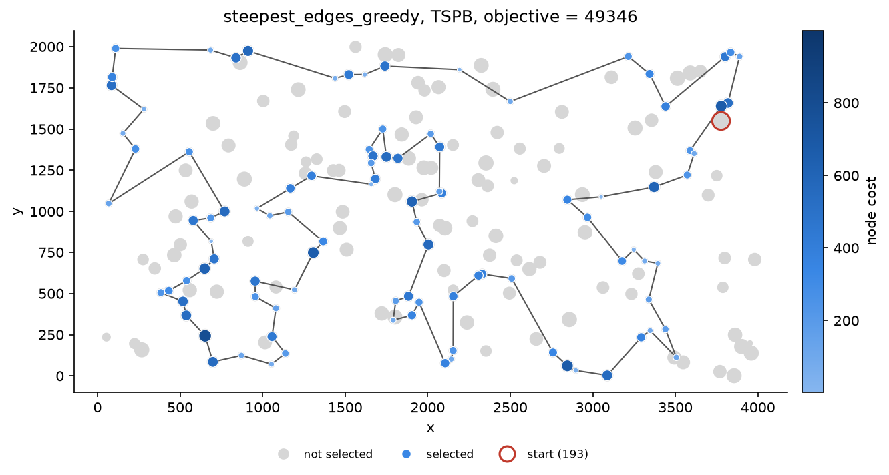{width=95%}

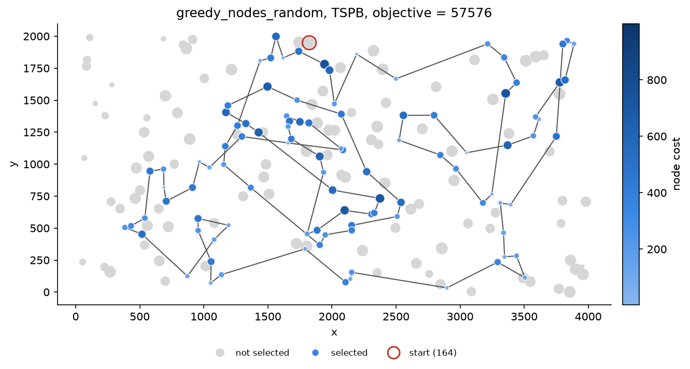{width=95%}

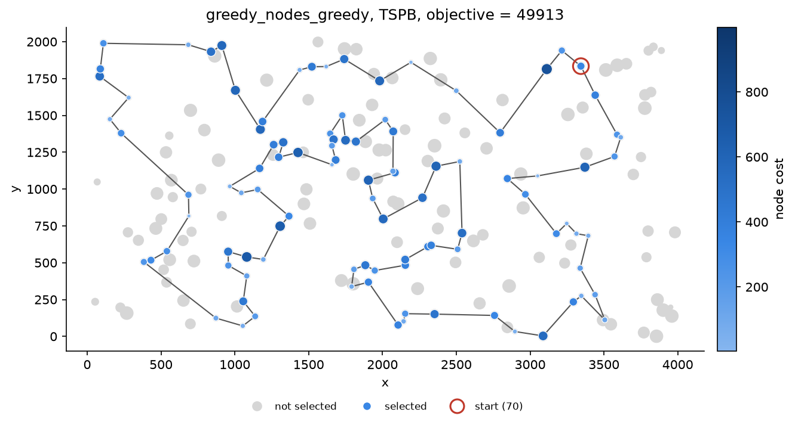{width=95%}

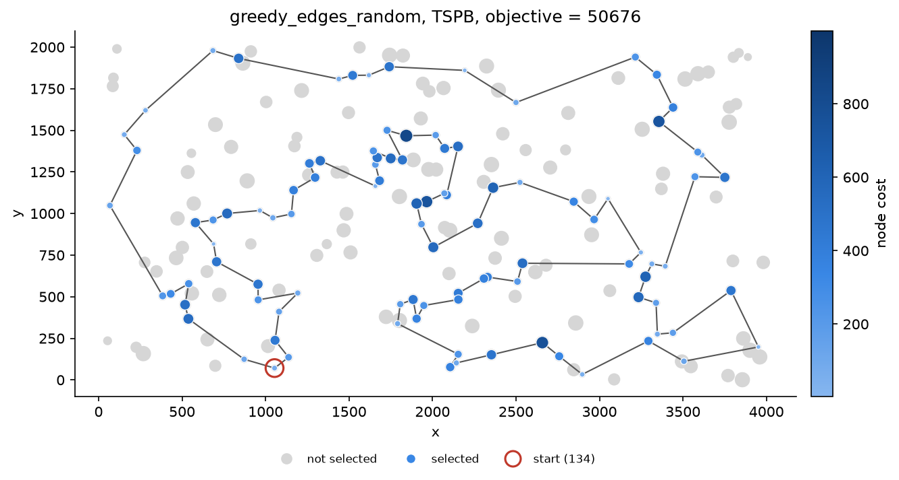{width=95%}

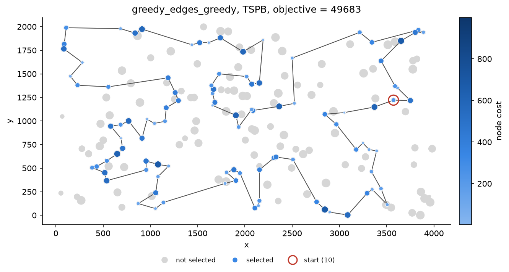{width=95%}

# Best solutions

Node indices start from 0. The cycle closes from the last node back to the first one. 

steepest_nodes_random, TSPA (81798):


76, 67, 144, 52, 16, 51, 35, 156, 102, 28, 180, 30, 141, 45, 58, 72, 176, 164, 186, 136, 184, 178, 47, 170, 146, 50, 3, 93, 130, 159, 107, 113, 106, 150, 85, 169, 1, 101, 29, 55, 147, 153, 193, 78, 88, 174, 8, 131, 99, 36, 54, 9, 33, 177, 73, 135, 114, 181, 192, 158, 182, 57, 89, 42, 151, 134, 84, 179, 53, 140, 185, 87, 189, 187, 2, 171, 92, 69, 127, 97, 95, 168, 116, 149, 63, 11, 49, 123, 83, 90, 132, 157, 91, 48, 60, 108, 152, 80, 71, 4


steepest_nodes_greedy, TSPA (71955):

101, 55, 29, 178, 184, 136, 186, 164, 1, 169, 3, 50, 93, 85, 174, 8, 54, 9, 33, 131, 36, 177, 52, 179, 53, 140, 144, 67, 16, 51, 35, 185, 102, 28, 180, 132, 76, 4, 71, 157, 91, 80, 48, 31, 108, 152, 100, 123, 83, 160, 49, 60, 116, 149, 63, 168, 97, 127, 161, 30, 187, 171, 2, 189, 141, 87, 45, 73, 135, 114, 181, 192, 158, 58, 84, 134, 72, 176, 150, 106, 113, 89, 42, 151, 138, 182, 57, 64, 107, 88, 78, 193, 153, 170, 146, 159, 130, 47, 37, 147

steepest_edges_random, TSPA (73550):

159, 146, 170, 153, 193, 78, 88, 107, 64, 57, 182, 151, 42, 89, 113, 43, 106, 150, 174, 176, 72, 134, 158, 58, 84, 131, 36, 177, 179, 53, 140, 73, 135, 45, 87, 28, 180, 4, 76, 132, 90, 100, 123, 83, 160, 30, 141, 187, 189, 2, 171, 92, 69, 127, 97, 168, 116, 149, 63, 11, 49, 152, 108, 60, 31, 48, 80, 91, 157, 71, 139, 51, 16, 35, 156, 185, 67, 144, 52, 33, 9, 54, 8, 142, 164, 186, 136, 184, 178, 163, 29, 101, 147, 1, 169, 3, 50, 93, 47, 130

steepest_edges_greedy, TSPA (71955):

55, 101, 147, 37, 47, 130, 159, 146, 170, 153, 193, 78, 88, 107, 64, 57, 182, 138, 151, 42, 89, 113, 106, 150, 176, 72, 134, 84, 58, 158, 192, 181, 114, 135, 73, 45, 87, 141, 189, 2, 171, 187, 30, 161, 127, 97, 168, 63, 149, 116, 60, 49, 160, 83, 123, 100, 152, 108, 31, 48, 80, 91, 157, 71, 4, 76, 132, 180, 28, 102, 185, 35, 51, 16, 67, 144, 140, 53, 179, 52, 177, 36, 131, 33, 9, 54, 8, 174, 85, 93, 50, 3, 169, 1, 164, 186, 136, 184, 178, 29

greedy_nodes_random, TSPA (81234):

161, 141, 28, 180, 132, 76, 157, 71, 4, 144, 53, 140, 73, 61, 41, 84, 58, 158, 138, 151, 42, 89, 106, 174, 8, 142, 164, 3, 50, 169, 1, 29, 55, 101, 93, 150, 192, 181, 114, 25, 98, 45, 135, 134, 72, 176, 182, 57, 64, 107, 88, 153, 159, 130, 47, 147, 178, 184, 136, 186, 62, 112, 139, 51, 16, 67, 52, 179, 177, 36, 131, 54, 9, 33, 143, 91, 80, 48, 152, 108, 60, 116, 149, 63, 168, 49, 160, 30, 187, 171, 2, 87, 102, 185, 35, 156, 90, 123, 97, 127

greedy_nodes_greedy, TSPA (71955):

101, 55, 29, 178, 184, 136, 186, 164, 1, 169, 3, 50, 93, 85, 174, 8, 54, 9, 33, 131, 36, 177, 52, 179, 53, 140, 144, 67, 16, 51, 35, 185, 102, 28, 180, 132, 76, 4, 71, 157, 91, 80, 48, 31, 108, 152, 100, 123, 83, 160, 49, 60, 116, 149, 63, 168, 97, 127, 161, 30, 187, 171, 2, 189, 141, 87, 45, 73, 135, 114, 181, 192, 158, 58, 84, 134, 72, 176, 150, 106, 113, 89, 42, 151, 138, 182, 57, 64, 107, 88, 78, 193, 153, 170, 146, 159, 130, 47, 37, 147

greedy_edges_random, TSPA (74023):

150, 176, 174, 54, 9, 194, 8, 142, 85, 164, 136, 29, 178, 1, 147, 47, 50, 3, 93, 130, 159, 146, 170, 75, 153, 193, 78, 88, 107, 64, 57, 182, 158, 192, 181, 114, 135, 73, 45, 185, 102, 28, 180, 87, 141, 30, 187, 189, 2, 171, 69, 127, 95, 97, 160, 123, 100, 152, 108, 49, 168, 63, 149, 116, 60, 48, 80, 91, 132, 76, 71, 157, 115, 112, 139, 51, 16, 156, 35, 67, 144, 140, 53, 179, 52, 177, 36, 33, 131, 99, 84, 58, 134, 72, 151, 42, 89, 113, 43, 106

greedy_edges_greedy, TSPA (71955):

55, 101, 147, 37, 47, 130, 159, 146, 170, 153, 193, 78, 88, 107, 64, 57, 182, 138, 151, 42, 89, 113, 106, 150, 176, 72, 134, 84, 58, 158, 192, 181, 114, 135, 73, 45, 87, 141, 189, 2, 171, 187, 30, 161, 127, 97, 168, 63, 149, 116, 60, 49, 160, 83, 123, 100, 152, 108, 31, 48, 80, 91, 157, 71, 4, 76, 132, 180, 28, 102, 185, 35, 51, 16, 67, 144, 140, 53, 179, 52, 177, 36, 131, 33, 9, 54, 8, 174, 85, 93, 50, 3, 169, 1, 164, 186, 136, 184, 178, 29

steepest_nodes_random, TSPB (58601):

118, 110, 2, 14, 20, 74, 153, 182, 52, 127, 10, 114, 196, 54, 144, 185, 76, 162, 159, 192, 84, 66, 27, 86, 46, 184, 3, 111, 25, 152, 181, 179, 87, 51, 73, 151, 122, 8, 117, 72, 190, 70, 94, 105, 187, 104, 57, 89, 48, 96, 198, 120, 133, 69, 64, 97, 170, 125, 177, 158, 130, 121, 42, 147, 116, 149, 28, 65, 178, 132, 29, 6, 115, 154, 140, 47, 38, 21, 30, 183, 136, 172, 160, 98, 24, 34, 85, 45, 134, 175, 157, 60, 71, 40, 59, 167, 67, 80, 129, 90

steepest_nodes_greedy, TSPB (49978):

65, 145, 28, 149, 13, 146, 37, 116, 147, 42, 50, 191, 130, 121, 198, 96, 48, 156, 89, 57, 185, 76, 162, 54, 192, 80, 127, 129, 90, 153, 14, 2, 20, 74, 17, 171, 99, 88, 179, 87, 82, 51, 85, 59, 73, 167, 181, 152, 34, 24, 67, 66, 27, 98, 151, 122, 3, 184, 46, 72, 117, 8, 120, 133, 136, 172, 160, 69, 189, 21, 183, 30, 38, 154, 140, 47, 64, 33, 40, 141, 155, 71, 60, 157, 45, 134, 175, 62, 36, 197, 6, 115, 170, 125, 177, 178, 29, 132, 174, 1

steepest_edges_random, TSPB (49789):

129, 127, 80, 192, 162, 54, 10, 148, 114, 196, 18, 187, 105, 94, 70, 190, 57, 185, 76, 86, 46, 72, 89, 156, 48, 96, 198, 121, 42, 147, 116, 37, 146, 13, 149, 28, 145, 65, 178, 103, 132, 29, 6, 197, 36, 62, 175, 134, 45, 157, 60, 40, 71, 155, 97, 115, 170, 177, 125, 154, 140, 47, 38, 21, 30, 183, 69, 160, 172, 136, 133, 120, 117, 184, 3, 122, 151, 167, 51, 59, 85, 82, 87, 179, 181, 152, 34, 24, 66, 84, 67, 31, 99, 171, 74, 20, 2, 14, 153, 90

steepest_edges_greedy, TSPB (49346):

65, 145, 28, 149, 13, 146, 37, 116, 147, 42, 121, 198, 96, 48, 89, 57, 190, 70, 187, 81, 94, 105, 61, 139, 196, 114, 10, 78, 54, 162, 192, 80, 127, 129, 90, 153, 14, 2, 20, 74, 17, 171, 39, 99, 67, 24, 34, 181, 179, 87, 82, 167, 51, 85, 59, 73, 98, 151, 122, 3, 184, 46, 72, 117, 8, 120, 133, 136, 172, 160, 69, 21, 38, 154, 140, 47, 64, 33, 40, 155, 71, 60, 157, 45, 134, 175, 62, 91, 36, 197, 132, 29, 6, 180, 115, 170, 177, 125, 26, 158

greedy_nodes_random, TSPB (57576):

71, 155, 40, 60, 175, 197, 132, 29, 6, 177, 125, 170, 115, 97, 154, 140, 21, 69, 3, 184, 117, 8, 133, 136, 172, 160, 122, 151, 59, 73, 25, 34, 24, 11, 98, 189, 183, 191, 130, 63, 120, 46, 27, 66, 67, 152, 181, 167, 51, 64, 47, 38, 30, 121, 198, 58, 96, 48, 43, 156, 72, 89, 57, 190, 70, 187, 18, 127, 80, 192, 162, 76, 185, 104, 54, 78, 10, 114, 196, 139, 61, 105, 94, 81, 148, 90, 129, 153, 20, 14, 2, 74, 171, 179, 87, 82, 85, 45, 134, 157

greedy_nodes_greedy, TSPB (49913):

125, 145, 28, 149, 13, 146, 37, 116, 147, 42, 50, 191, 130, 121, 198, 96, 48, 156, 89, 57, 104, 194, 190, 70, 187, 196, 114, 10, 78, 54, 162, 192, 80, 127, 129, 90, 153, 14, 2, 20, 74, 17, 171, 99, 88, 179, 87, 82, 51, 85, 59, 73, 167, 181, 152, 34, 24, 67, 66, 76, 135, 27, 98, 151, 122, 3, 184, 46, 72, 117, 8, 120, 133, 136, 172, 160, 69, 189, 21, 183, 30, 38, 154, 140, 47, 64, 33, 40, 141, 155, 71, 60, 157, 45, 134, 175, 132, 29, 6, 170

greedy_edges_random, TSPB (50676):

26, 154, 140, 47, 38, 21, 30, 183, 69, 160, 172, 136, 133, 8, 117, 120, 92, 72, 46, 86, 3, 184, 173, 122, 151, 98, 27, 135, 76, 162, 192, 54, 127, 80, 66, 67, 24, 34, 152, 181, 167, 51, 73, 59, 85, 179, 82, 87, 88, 163, 99, 171, 74, 2, 110, 118, 14, 20, 153, 182, 52, 129, 90, 10, 148, 114, 196, 18, 187, 70, 190, 57, 89, 48, 96, 198, 121, 147, 116, 149, 28, 145, 65, 132, 29, 6, 197, 36, 175, 134, 45, 157, 60, 40, 71, 155, 115, 170, 177, 125

greedy_edges_greedy, TSPB (49683):

105, 94, 70, 190, 57, 76, 135, 3, 184, 151, 122, 69, 160, 172, 136, 133, 120, 72, 46, 86, 89, 156, 48, 96, 198, 121, 42, 147, 116, 37, 146, 13, 149, 28, 145, 158, 130, 30, 21, 38, 47, 140, 154, 97, 26, 125, 177, 170, 115, 180, 6, 29, 132, 197, 36, 71, 155, 141, 40, 60, 157, 175, 134, 45, 85, 51, 59, 73, 167, 82, 87, 179, 181, 34, 24, 67, 99, 39, 171, 17, 74, 20, 2, 14, 153, 90, 129, 127, 80, 192, 162, 54, 78, 10, 148, 114, 196, 187, 169, 81


# Solution checker

Every solution was validated in the program as described above, using the same objective function that was tested against the example solutions in the checker in Assignment 1.

The best solutions of all eight methods on both instances, were also pasted into column F of a copy of the solution checker (by a script, `scripts/checker.py`, which opens the copy in Numbers and reads the total from cell K2). For all sixteen solutions the checker gives the same objective values as in the table.

# Source code

<https://github.com/ZiarnoM/evolutionary-computation/tree/assignment-3>

Both new criteria are in `src/methods/local_search.cpp`. The common code is in `src/core` and the experiment, is in `src/main.cpp`. Plots and tables are made by the Python scripts in `scripts`.

# Conclusions

Local search substantially improves the results when it starts from a good construction solution. On TSPA, the best average objective was obtained by steepest descent with 2-opt moves and a greedy starting solution (72751.6). This is an improvement over the best construction method, greedy cycle (73793.4), although the difference is relatively small. The best individual objective was 71955, achieved by all four methods using a greedy starting solution.

On TSPB, the improvement is more significant. The best average was obtained by steepest descent with 2-opt moves and a random starting solution (52524.8). This is about 11.7% better than the best average of the construction methods, nearest neighbor with insertion at any position (59475.5). The best individual solution was also found by steepest descent with 2-opt moves and a greedy starting solution, with an objective of 49346.

The choice of the initial solution has a large impact on the results. All four methods using a random starting solution perform considerably worse on average than their greedy-start counterparts. For example, on TSPA the average objective of steepest node exchange decreases from 89804.2 to 72859.8 when using the greedy starting solution. On TSPB it decreases from 66004.1 to 53822.2. This suggests that local search is much more effective when it starts from a solution that is already reasonably close to a good local optimum.

The difference between steepest and greedy descent depends on the move type and instance. With node exchanges, greedy descent is slightly better on average than steepest descent for both instances when using the same type of starting solution. With 2-opt moves, steepest descent performs better on average than greedy descent for both instances. However, the differences are generally small when starting from a greedy solution. The best objective values are also very similar, which suggests that the choice of initial solution is more important than the choice between the two descent strategies in these experiments.

The two intra-route neighborhoods behave differently. Node exchanges can change the order of two selected nodes directly, while 2-opt reverses a segment of the cycle. On TSPA, node exchanges with a greedy start give slightly better averages than 2-opt with a greedy start. On TSPB, 2-opt gives better averages and the best individual solution. This indicates that the usefulness of a neighborhood depends on the instance and on the structure of its good solutions.

The running times differ considerably between methods. Steepest descent with a random starting solution takes about 103 ms for node exchanges and 38 ms for 2-opt on TSPA. Greedy descent with a random starting solution is slower, taking about 299 ms for node exchanges and 288 ms for 2-opt. This is because greedy descent can accept relatively small improvements and may require many iterations before reaching a local optimum. In contrast, steepest descent selects the best available improvement in each iteration and often reaches a local optimum in fewer iterations.

Methods with greedy starting solutions are much faster despite the additional cost of constructing and comparing the initial candidates. Their starting solutions are already good, so the local search needs fewer improvements before terminating. For example, greedy descent with node exchanges takes about 26 ms on TSPA with a greedy start, compared with about 299 ms with a random start.

Overall, the experiments show that local search is particularly effective when combined with a good initial construction solution. The best method is not the same for both instances: steepest descent with 2-opt and a random start gives the best average on TSPB, while steepest descent with 2-opt and a greedy start gives the best average on TSPA. The results also show that the quality of the initial solution has a major influence on both the final objective and the running time.