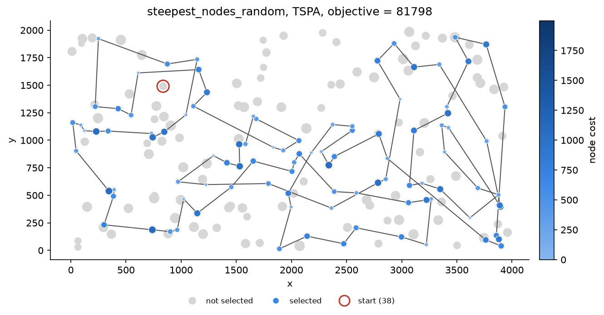
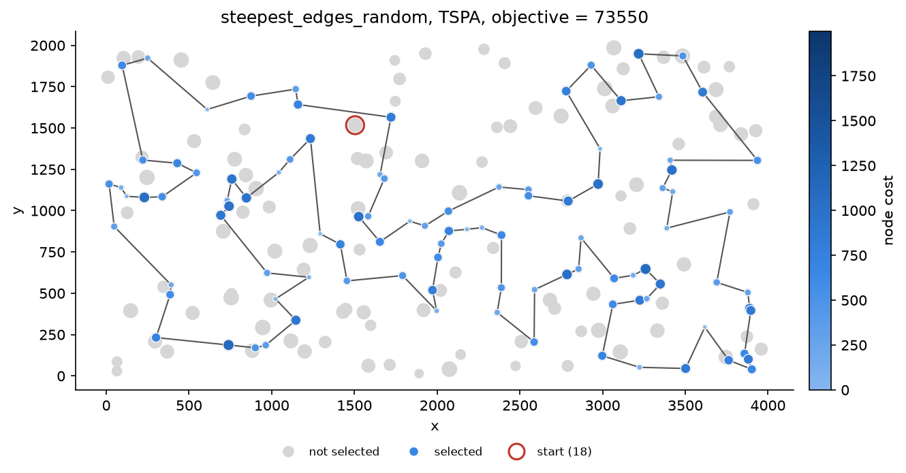
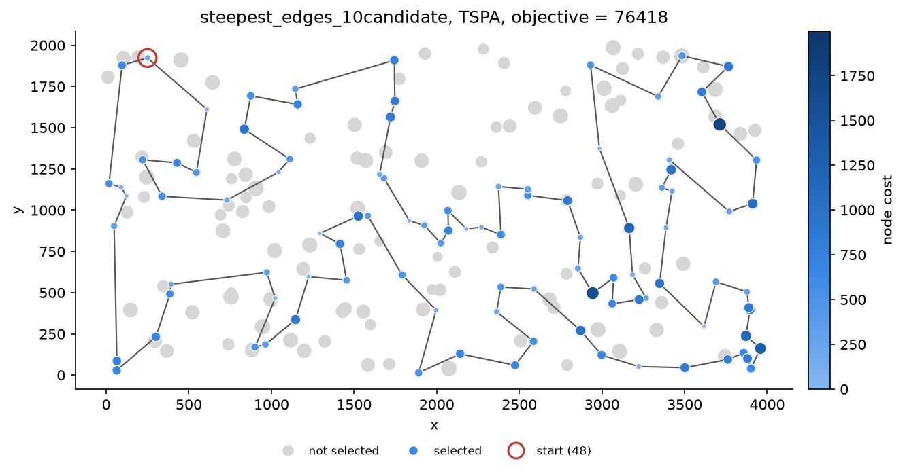
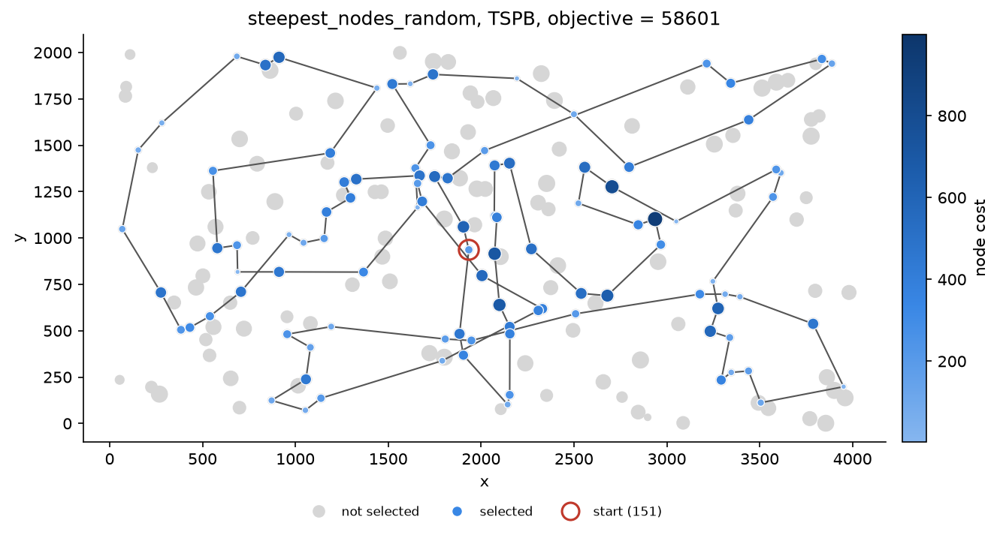
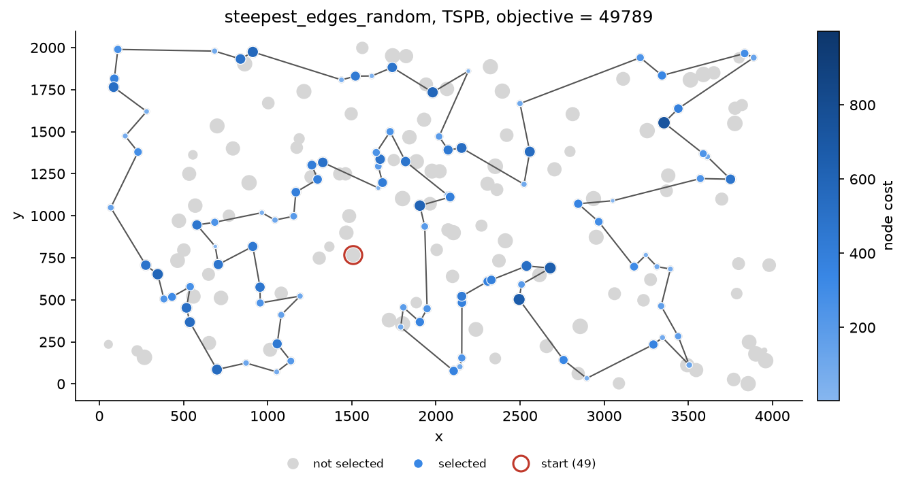
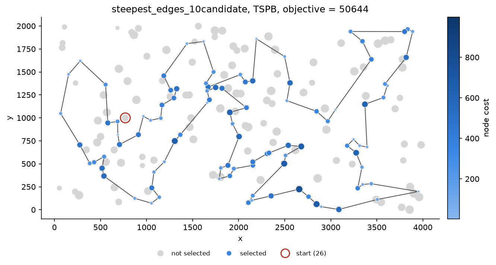
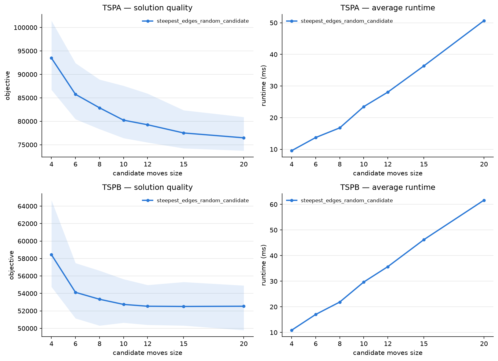

# Problem description

We are given a set of nodes, each with x and y coordinates and a cost. The task is to select exactly half of the nodes (rounded up if the number of nodes is odd) and to form a Hamiltonian cycle through the selected nodes. The goal is to minimize the length of the cycle plus the total cost of the selected nodes. Distances are Euclidean, rounded mathematically to integers, computed in the same way as in the solution checker: `(int)(sqrt(dx*dx + dy*dy) + 0.5)`.

Both instances, TSPA and TSPB, have 200 nodes, so every solution contains 100 nodes. The distance matrix is computed right after reading an instance and the coordinates are then discarded, so the optimization methods only see the distance matrix and the node costs.

## Implemented Methods

The candidate local search method restricts the neighborhood by considering only moves involving edges from precomputed lists of the \(k\) nearest candidate nodes. For intra-route moves, candidates are selected based on distance; for inter-route replacements, both distance and node cost are considered. Only moves introducing at least one candidate edge are evaluated. The algorithm then applies the best improving move (steepest descent), repeating until no further improvement is found.

### **Delta Calculation**

### 1. Intra-route edge exchange

The objective change for a 2-opt move is:

$$
\Delta_{\mathrm{edges}} =
d(a,c) + d(b,d)
- d(a,b) - d(c,d)
$$

where

$$
a=x_i,\quad
b=x_{(i+1)\bmod k},\quad
c=x_j,\quad
d=x_{(j+1)\bmod k}.
$$

### 2. Inter-route node exchange

The objective change for replacing a selected node with an unselected candidate is:

$$
\begin{aligned}
\Delta_{\mathrm{inter}} ={}&
d(p,y) + d(y,s)\\
&- d(p,x) - d(x,s)\\
&+ c(y) - c(x).
\end{aligned}
$$

where

$$
p=x_{(i-1)\bmod k},\quad
x=x_i,\quad
s=x_{(i+1)\bmod k}.
$$


### Pseudocode
Following procedure was used:

```
CANDIDATE_LOCAL_SEARCH(I, start, search_type, greedy_start, q)

    n ← number of nodes
    k ← number of nodes to select

    S ← random feasible solution

    Mark all nodes in S as selected

    intra_candidates ← BUILD_CANDIDATES(I, q, FALSE)
    inter_candidates ← BUILD_CANDIDATES(I, q, TRUE)

    Initialize random number generator with seed 42 + start

    REPEAT
        moves ← GENERATE_CANDIDATE_MOVES(I, S, intra_candidates, inter_candidates)

        found ← FALSE
        best_delta ← 0

        FOR each move IN moves DO

            Calculate objective change Δ according to move type

            IF Δ < 0 THEN
                IF found = FALSE OR Δ < best_delta THEN
                    best_move ← move
                    best_delta ← Δ
                    found ← TRUE
                END IF
            END IF
        END FOR

        IF found = FALSE THEN
            BREAK
        END IF

        APPLY_MOVE(best_move, S)
        Update selected-node information
        S.objective ← S.objective + best_delta

    UNTIL no improving move exists

    RETURN S
```

```
BUILD_CANDIDATES(I, q, include_cost)

    FOR each node i DO
        ranked ← empty list

        FOR each node j DO
            IF i = j THEN
                CONTINUE
            END IF

            score ← distance(i, j)

            IF include_cost = TRUE THEN
                score ← score + cost(j)
            END IF

            Add (score, j) to ranked
        END FOR

        Sort ranked in ascending order
        candidates[i] ← first min(q, n - 1) nodes from ranked
    END FOR

    RETURN candidates
```
```
GENERATE_CANDIDATE_MOVES(S, used, intra_candidates, inter_candidates)

    moves ← empty list
    seen ← empty set

    Build position array:
        position[node] ← its position in S
        position[node] ← -1 if node is not selected

    GENERATE_INTER_MOVES()
    GENERATE_NODE_EXCHANGE_MOVES()

    RETURN moves
```
```
GENERATE_INTER_MOVES()

    FOR each position i in the cycle DO

        prev ← predecessor of S[i]
        next ← successor of S[i]

        FOR endpoint IN {prev, next} DO

            FOR each candidate y in inter_candidates[endpoint] DO

                IF y is already selected THEN
                    CONTINUE
                END IF

                IF (endpoint, y) is not a candidate edge THEN
                    CONTINUE
                END IF

                IF move (REPLACE, i, y) has not been generated THEN
                    Add (REPLACE, i, y) to moves
                END IF

            END FOR
        END FOR
    END FOR
```
```
GENERATE_EDGE_EXCHANGE_MOVES()

    FOR each selected node a DO

        p_a ← position[a]

        FOR each node b in intra_candidates[a] DO

            IF b is not selected OR a = b THEN
                CONTINUE
            END IF

            p_b ← position[b]

            pred_a ← (p_a - 1) mod k
            pred_b ← (p_b - 1) mod k

            // Generate both possible 2-opt moves
            ADD_TWO_OPT_CANDIDATE(p_a, p_b)
            ADD_TWO_OPT_CANDIDATE(pred_a, pred_b)

        END FOR
    END FOR
```
```
APPLY_MOVE(move, S, used)

    IF move type = INTER THEN

        removed ← S[move.i]
        inserted ← move.j

        S[move.i] ← inserted

        used[removed] ← FALSE
        used[inserted] ← TRUE

    ELSE IF move type = INTRA THEN

        Reverse the segment of S from move.i + 1 to move.j

    END IF
```

# Implementation notes

All methods have the same interface: they take the instance and the starting node and return the solution together with its objective value. The objective is updated incrementally using the delta of every accepted move.

A boolean array tracks which nodes are currently selected. This allows inter-route moves to be checked efficiently: a candidate can only be inserted if it is not already selected. After an accepted inter-route move, the array is updated to reflect the removed and inserted nodes.

The random generator is initialized using the starting node, so the solution generation is reproducible for a given start.

After every run the solution is validated: it must contain exactly `k` nodes, all indices must be in range, there can be no duplicates, and the objective recomputed from scratch must be equal to the value returned by the method.

The main experiment was run on both 200-node instances. Each local search method was tested from the starting nodes, with random starting solutions generated separately. The four construction methods from the previous assignment are included as baselines.

# Results

## Objective values

Table: Objective value, average (min - max) over 200 runs. The best average and the best solution on each instance are in bold.

| Method | TSPA | TSPB |
|---|---:|---:|
| Random solution | 261399.3 (232308 - 295992) | 206656.5 (182243 - 225227) |
| Nearest neighbor (end only) | 87476.6 (84362 - 90075) | 59397.3 (56007 - 63166) |
| Nearest neighbor (any position) | 74347.0 (72328 - 77022) | 59475.5 (52915 - 66164) |
| Greedy cycle | 73793.4 (72590 - 75281) | 59649.9 (55655 - 63734) |
| NN (any position), 2-regret | 121360.3 (110950 - 135771) | 73649.8 (68761 - 79756) |
| NN (any position), weighted | 75549.4 (72419 - 78504) | 55698.9 (50485 - 61406) |
| Greedy cycle, 2-regret | 120378.8 (112806 - 128089) | 72484.8 (68150 - 77274) |
| Greedy cycle, weighted | 73353.5 (72011 - 75532) | 57863.3 (52731 - 63370) |
| Steepest nodes, random start | 89804.2 (81798 - 98238) | 66004.1 (58601 - 74372) |
| Steepest nodes, greedy start | 72859.8 (**71955** - 74575) | 53822.2 (49978 - 60809) |
| Steepest edges, random start | 76282.2 (73550 - 79026) | **52524.8** (49789 - 55489) |
| Steepest edges, greedy start | **72751.6** (**71955** - 74575) | 53109.0 (**49346** - 59040) |
| Greedy nodes, random start | 88009.7 (81234 - 96055) | 63856.6 (57576 - 71226) |
| Greedy nodes, greedy start | 72858.7 (**71955** - 74575) | 53809.6 (49913 - 60809) |
| Greedy edges, random start | 76224.1 (74023 - 79349) | 52941.9 (50676 - 55402) |
| Greedy edges, greedy start | 72753.5 (**71955** - 74575) | 53161.2 (49683 - 59278) |
| Steepest edges, 10 candidates | 80241.7 (76418 - 87573) | 52741.0 (50644 - 55637) |


## Average running time

Table: Average time of one run in milliseconds.

| Method | TSPA | TSPB |
|---|---:|---:|
| Random solution | 0.006 | 0.017 |
| Nearest neighbor (end only) | 0.066 | 0.100 |
| Nearest neighbor (any position) | 1.206 | 1.514 |
| Greedy cycle | 1.741 | 1.836 |
| NN (any position), 2-regret | 0.801 | 0.801 |
| NN (any position), weighted | 0.797 | 0.798 |
| Greedy cycle, 2-regret | 0.857 | 0.857 |
| Greedy cycle, weighted | 0.859 | 0.852 |
| Steepest nodes, random start | 103.268 | 111.644 |
| Steepest nodes, greedy start | 20.220 | 28.881 |
| Steepest edges, random start | 37.648 | 39.550 |
| Steepest edges, greedy start | 19.225 | 22.970 |
| Greedy nodes, random start | 299.363 | 299.453 |
| Greedy nodes, greedy start | 26.378 | 38.782 |
| Greedy edges, random start | 287.531 | 371.313 |
| Greedy edges, greedy start | 21.624 | 43.406 |
| Steepest edges, 10 candidates | 27.477 | 31.650 |


# Visualization of the best solutions

The plots show the best solutions found by the local search methods on both instances. The plots for the construction methods from the previous assignment can be found in the previous report.

The size of every node shows its cost. Grey points are nodes that were not selected, while selected nodes are coloured by cost (darker means more expensive). The size and colour scales are the same for all methods on one instance. The red circle marks the starting node of the best run.


{width=95%}

{width=95%}

{width=95%}

{width=95%}

{width=95%}

{width=95%}

# Different candidate moves sizes

We also tried experimenting with different candidate moves sizes: 4, 6, 8, 10, 12, 15, 20.

{width=95%}

The experiments show a clear relationship between the number of candidates considered and the trade-off between solution quality and execution time. For both instances, increasing the candidate count generally improves the average objective value, but also increases the average running time. On TSPA, the average objective decreases consistently from 93,480.98 with 4 candidates to 76,476.80 with 20 candidates. However, the improvement becomes progressively smaller: increasing the candidate count from 15 to 20 improves the average objective by only about 1,036, while increasing the running time from 36.36 ms to 50.66 ms. On TSPB, the largest improvement occurs when increasing the candidate count from 4 to 8, reducing the average objective from 58,441.20 to 53,332.26. Further increases bring only modest improvements: the best average value is obtained with 15 candidates (52,505.96), while using 20 candidates gives a slightly worse result (52,531.48). At the same time, the average running time increases substantially, from 21.87 ms with 8 candidates to 46.23 ms with 15 and 61.64 ms with 20. These results suggest that a larger candidate list allows the algorithm to explore more possible moves and usually find better solutions, but the additional computational cost eventually outweighs the improvement in solution quality. A candidate count of 10 appears to be a reasonable compromise, particularly on TSPB, where it achieves an average objective of 52,740.96 in 29.69 ms, close to the best average result while requiring considerably less time. On TSPA, however, larger candidate lists continue to provide noticeable improvements, so the most suitable candidate count depends on the instance and the desired balance between solution quality and execution time.


# Best solutions

Node indices start from 0. The cycle closes from the last node back to the first one. 

steepest_edges_10candidate, TSPA (76418):

2, 189, 141, 87, 28, 180, 156, 35, 45, 135, 114, 181, 192, 158, 58, 84, 134, 138, 182, 57, 64, 88, 153, 193, 78, 26, 75, 170, 146, 159, 130, 107, 113, 93, 50, 3, 169, 1, 47, 37, 147, 155, 101, 55, 29, 178, 136, 164, 81, 106, 89, 42, 151, 150, 0, 176, 174, 8, 54, 9, 33, 131, 36, 177, 52, 179, 53, 144, 67, 16, 51, 139, 112, 115, 157, 71, 91, 38, 76, 132, 123, 49, 60, 108, 152, 80, 48, 31, 116, 149, 63, 168, 129, 104, 69, 127, 97, 30, 187, 171

steepest_edges_10candidate, TSPB (50644):

192, 162, 76, 185, 57, 89, 86, 46, 72, 136, 133, 120, 96, 121, 130, 30, 183, 21, 38, 47, 140, 154, 97, 115, 170, 125, 177, 158, 149, 28, 65, 178, 132, 29, 6, 197, 36, 175, 134, 45, 157, 60, 40, 33, 64, 69, 160, 172, 8, 117, 184, 3, 122, 151, 98, 73, 59, 85, 51, 167, 181, 152, 34, 24, 66, 84, 67, 31, 179, 82, 87, 88, 163, 99, 39, 171, 17, 2, 110, 14, 20, 74, 153, 52, 80, 127, 129, 90, 78, 10, 114, 196, 61, 105, 94, 81, 190, 70, 187, 54

# Solution checker

Every solution was validated in the program as described above, using the same objective function that was tested against the example solutions in the checker in Assignment 1.

The best solutions of all eight methods on both instances, were also pasted into column F of a copy of the solution checker (by a script, `scripts/checker.py`, which opens the copy in Numbers and reads the total from cell K2). For both solutions the checker gives the same objective values as in the table.

# Source code

<https://github.com/ZiarnoM/evolutionary-computation/tree/assignment-4>


New method iss in `src/methods/candidate_moves_local_search.cpp`. The common code is in `src/core` and the experiment, is in `src/main.cpp`. Plots and tables are made by the Python scripts in `scripts`.

# Conclusions

## **Conclusions**

The results show that the new **Steepest edges, 10 candidates** method provides a good compromise between solution quality and computational efficiency. However, its performance differs between the two instances.

\- **Objective value:** On TSPA, the new method achieves an average objective value of 80,241.7. This is better than the methods starting from random solutions, but worse than all the local search methods starting from greedy solutions. On TSPB, it achieves 52,741.0, which is a competitive result: it outperforms both steepest and greedy edge-based local search with greedy initial solutions (53,109.0 and 53,161.2, respectively), as well as the corresponding node-based methods (53,822.2 and 53,809.6). It is, however, slightly worse than steepest edges with a random start (52,524.8).

\- **Solution quality compared with construction heuristics:** The new method significantly improves on the basic construction heuristics in most cases. For example, on TSPA its average objective is lower than that of greedy cycle (73,793.4) only in the opposite direction: the new method's result is higher. This indicates that, for TSPA, the candidate restriction does not provide enough improvement to compete with the strongest construction and local-search approaches. On TSPB, the new method improves on the greedy cycle result (59,649.9) by approximately 11.6%.

\- **Running time:** The new method requires 27.477 ms per run on TSPA and 31.650 ms on TSPB. It is faster than the full steepest edge-based search with a random start (37.648 ms and 39.550 ms), but slower than the same search with a greedy start (19.225 ms and 22.970 ms). It is also considerably faster than the greedy local search variants, particularly those starting from random solutions.

\- **Effect of candidate restriction:** Limiting the search to 10 candidates reduces the computational cost compared with the unrestricted steepest edge-based search with a random start. However, this comes at the cost of solution quality on TSPA: the average objective increases from 76,282.2 to 80,241.7. On TSPB, the difference is much smaller, with the candidate-based method obtaining 52,741.0 compared with 52,524.8 for the unrestricted version.

\- **Best solutions:** The new method does not find the best solution observed in either instance. Its minimum values are 76,418 on TSPA and 50,644 on TSPB, whereas the best observed values are 71,955 and 49,346, respectively. This suggests that restricting the candidate set may reduce the search's ability to reach the best solutions found by other variants.

### **Overall conclusion**

The new **Steepest edges, 10 candidates** method offers a reasonable balance between running time and solution quality, particularly on TSPB, where it achieves results close to the unrestricted steepest edge-based search while reducing execution time. On TSPA, however, the loss in solution quality is more noticeable, and the method is outperformed by several approaches using greedy initial solutions. Therefore, the effectiveness of candidate restriction appears to depend on the instance. It can reduce the computational effort while retaining competitive results, but using only 10 candidates does not consistently provide the best trade-off across both instances.