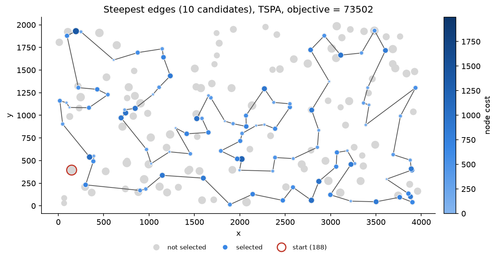
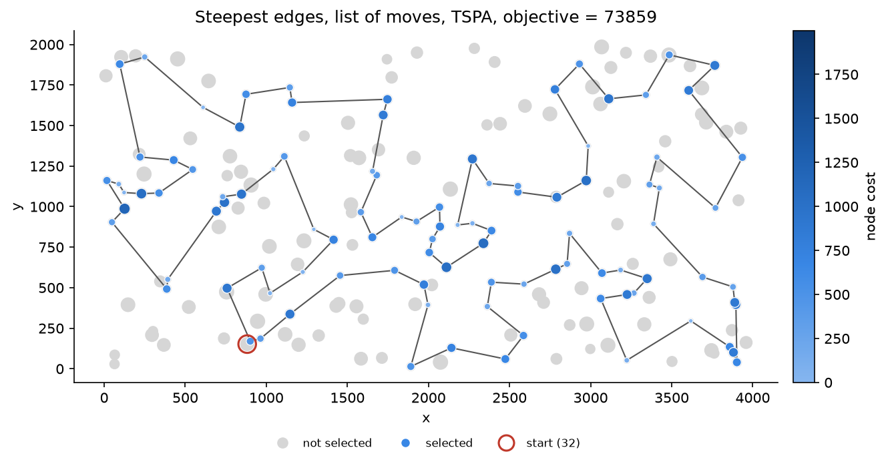
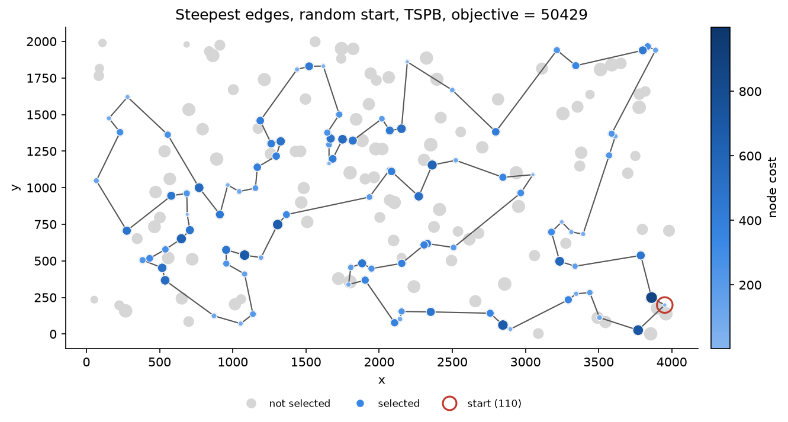
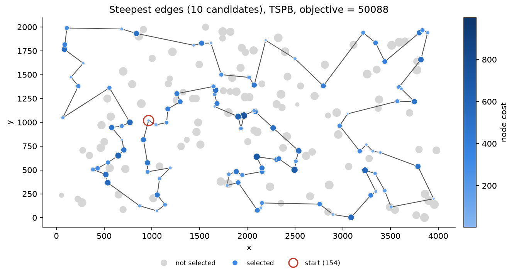

# Problem description

We are given a set of nodes, each with x and y coordinates and a cost. The task is to select exactly half of the nodes (rounded up if the number of nodes is odd) and to form a Hamiltonian cycle through the selected nodes. The goal is to minimize the length of the cycle plus the total cost of the selected nodes. Distances are Euclidean, rounded mathematically to integers, computed in the same way as in the solution checker: `(int)(sqrt(dx*dx + dy*dy) + 0.5)`.

Both instances, TSPA and TSPB, have 200 nodes, so every solution contains 100 nodes. The distance matrix is computed right after reading an instance and the coordinates are then discarded, so the optimization methods only see the distance matrix and the node costs.

# Implemented methods

In Assignment 3 the best neighborhood was the exchange of two edges (2-opt) as the intra-route move together with the exchange of a selected and an unselected node as the inter-route move. In this assignment the steepest local search with this neighborhood, started from random solutions, is sped up with a list of improving moves (LM). The baseline is the steepest local search with the same neighborhood and the same random starting solutions, which evaluates the whole neighborhood in every iteration. The candidate moves from Assignment 4 are not used together with the list.

In the following, `d` is the distance matrix and `c` is the vector of costs. For a 2-opt move that removes the edges `a->b` and `c->d` and adds `a-c` and `b-d` the change of the objective is `d[a][c] + d[b][d] - d[a][b] - d[c][d]`. For replacing a selected node `v` with neighbors `p` and `s` by an unselected node `u` it is `d[p][u] + d[u][s] - d[p][v] - d[v][s] + c[u] - c[v]`.

## Baseline and candidate moves

The point of the assignment is to compare running times, so the baseline should not lose time on things that have nothing to do with the list of moves. The local search from Assignment 3 built a new vector with all moves of the neighborhood in every iteration, and the delta of a node swap allocated a small vector on every call. We rewrote it so that the neighborhood is browsed with two loops directly over the solution, and in the loop over unselected nodes the part of the delta that depends only on the removed node is computed once. The moves are checked in the same order as before, so the steepest search gives exactly the same solutions as in Assignment 3 (for the same starting solutions), only the time changed. For this neighborhood one run went down from 14.9 ms to 1.95 ms on our machine.

The candidate moves from Assignment 4 were rewritten in the same way. In every iteration, for every selected node `a` and every node `b` from the candidate list of `a`, the moves that add the edge `a-b` are evaluated: two 2-opt moves if `b` is selected (removing the edges after `a` and after `b`, or the edges before `a` and before `b`), and two node exchanges if it is not (`b` replaces the successor or the predecessor of `a`). Before, the candidate list of a node was made of the 10 nodes with the smallest distance plus node cost. On TSPA the costs are large compared to distances, so these lists were filled with cheap but distant nodes, and the average objective was about 80000, 4000 worse than the full neighborhood. With the 10 nearest nodes by distance alone, as in the description of candidate moves in the lecture, the loss is much smaller, so this version is used here.

## Representation of moves

A move in the list is stored by the nodes it touches, not by their positions, because positions change after every applied move. A 2-opt move is stored as four nodes `(a, b, c, d)` and means "remove edges `a-b` and `c-d`, add edges `a-c` and `b-d`". A node exchange is stored as `(p, v, s, u)`: the removed node `v`, its two neighbors and the inserted node `u`. The delta of a move depends only on these nodes, so it stays correct as long as the move can be applied.

The moves found when the whole neighborhood is evaluated are sorted by delta once and read from the front, and the moves added later are kept in a binary heap. The next move to check is the better of the first unread sorted move and the top of the heap. We started with a `std::set`, but every insertion allocates memory, and from a random solution about 15000 moves go through the list in one run, so it was slower than the baseline.

## Checking a move from the list

When a 2-opt move `(a, b, c, d)` is taken from the list, there are three cases:

1. At least one of the edges `a-b`, `c-d` does not exist in the current cycle (in either direction). The move is removed from the list.
2. Both edges exist, but in different relative directions, for example `a->b` and `d->c`. Removing them and adding `a-c` and `b-d` would split the cycle into two, so the move cannot be applied now. It stays in the list, because it can become applicable after some later reversal of a segment.
3. Both edges exist in the same relative direction, `a->b` and `c->d` or both reversed, `b->a` and `d->c`. The move is applied and removed from the list. In the second case the segment between the edges is the same, only seen from the other side, so the new edges and the delta are the same.

For a node exchange the direction does not matter. The move is applicable if `u` is still unselected and the edges `p-v` and `v-s` still exist, otherwise it is removed. A move that became invalid because `u` was selected is not lost: when `u` is removed from the cycle again, all moves inserting `u` are evaluated anew.

## Evaluating new moves

For every pair of edges `a->b` and `c->d` of the current cycle two moves are evaluated: `(a, b, c, d)`, which can be applied now, and `(a, b, d, c)` with the second edge inverted, which removes the same edges but adds `a-d` and `b-c`. The second one is applicable only after the direction of one of the edges changes, but it has to be evaluated when the edges appear, because later the pair will not be looked at again. Both are added to the list if their delta is negative. This is done for the initial solution and for every new edge.

After a 2-opt move, the two new edges are evaluated against all edges of the cycle, in both relative directions. The edges inside the reversed segment are the same, only their direction changed, and the moves with both directions were already in the list. Node exchanges are evaluated again for the four nodes whose neighbors changed.

After a node exchange that replaced `v` by `u` between `p` and `s`, the new edges `p-u` and `u-s` are evaluated against all edges, the exchanges of `p`, `u` and `s` with every unselected node are evaluated, and so are the exchanges of every selected node with `v`, which is now unselected.

In both cases this is about 800 deltas, while the baseline computes 4850 deltas of 2-opt moves and 10000 deltas of node exchanges in every iteration.

## Pseudocode

```
x = random solution
LM = empty list of moves ordered by delta
add all improving moves of x to LM, 2-opt moves in both relative directions
repeat:
    m = none
    for move in LM from the best:
        if the removed edges of move do not exist (or the inserted node is selected):
            remove move from LM
        else if the removed edges have different relative directions:
            skip move, keep it in LM
        else:
            m = move, remove m from LM, stop browsing
    if m is not none:
        apply m to x, objective += delta(m)
        add improving moves using the new edges or the changed nodes to LM
    else:
        add all improving moves of x to LM
        if no move from LM is applicable: stop
return x
```

This is a mix of the two versions from the lecture. After every move only the new moves are evaluated, as in the standard version, and the full evaluation when nothing in the list is applicable comes from the alternative version. The lecture notes that the alternative version alone does not work exactly like the steepest search, only gives similar results, because moves are not evaluated after each move. With the new moves evaluated every time, the list always holds all improving moves, so the full evaluation is only a safety check. In our runs it never found a new improving move: it ran once at the end of every run and the search stopped right after it.

## Implementation notes

The cycle is kept in an array together with the position of every node (-1 for unselected nodes), so the predecessor and successor of a node and the check whether an edge exists take constant time. A 2-opt move reverses the shorter of the two parts of the cycle between the removed edges.

To check that the list gives the same search as the baseline, we ran a separate test that, before every move taken from the list, computed the best move in the whole neighborhood by brute force. In all 400 runs (53453 moves, about 134 per run) the delta of the applied move was equal to the best delta in the neighborhood, so the method is still a steepest local search and only the way of finding the best move changed.

All methods have the same interface: they take the instance and the starting node and return the solution together with the objective value, which they update incrementally from the deltas. After every run the solution is validated: it must contain exactly `k` nodes, all indices must be in range, there can be no duplicates, and the objective recomputed from scratch must be equal to the value returned by the method. All solutions passed these checks. The program was compiled with Apple clang 17 with `-O2` and run on an Apple M2 Pro. All methods in the tables were run again on this machine, so the times can be compared with each other but not with the times in the earlier reports.

# Results

Each method was run 200 times on each instance. The local search methods start from the same 200 random solutions (the random generator is seeded with the run number), the greedy methods start from every node. The first four rows are the construction methods from Assignment 1.

Table: Objective value, average (min - max) over 200 runs. The best average and the best solution on each instance are in bold.

| Method                 |                           TSPA |                           TSPB |
|------------------------|-------------------------------:|-------------------------------:|
| Random solution | 261657.6 (233510 - 292900) | 206274.9 (184873 - 230807) |
| Nearest neighbor (end only) | 87476.6 (84362 - 90075) | 59397.3 (56007 - 63166) |
| Nearest neighbor (any position) | 74347.0 (**72328** - 77022) | 59475.5 (52915 - 66164) |
| Greedy cycle | **73793.4** (72590 - 75281) | 59649.9 (55655 - 63734) |
| Steepest edges, random start | 76192.8 (73859 - 80012) | 52653.3 (50429 - 55421) |
| Steepest edges, 10 candidates | 76763.2 (73502 - 80722) | 52745.1 (**50088** - 56373) |
| Steepest edges, list of moves | 76205.3 (73859 - 80012) | **52622.6** (50429 - 55421) |

Table: Time of one run in milliseconds, average (min - max).

| Method                 |                           TSPA |                           TSPB |
|------------------------|-------------------------------:|-------------------------------:|
| Random solution | 0.021 | 0.004 |
| Nearest neighbor (end only) | 0.062 | 0.017 |
| Nearest neighbor (any position) | 0.756 | 0.642 |
| Greedy cycle | 0.596 | 0.615 |
| Steepest edges, random start | 1.953 (1.687 - 2.681) | 1.972 (1.698 - 2.455) |
| Steepest edges, 10 candidates | **0.879** (0.798 - 0.966) | **0.887** (0.791 - 0.980) |
| Steepest edges, list of moves | 1.169 (0.983 - 1.376) | 1.140 (0.981 - 1.457) |

The list of moves and the baseline give the same objective from the same starting solution in 177 of 200 runs on TSPA and in 164 of 200 runs on TSPB. In the other runs there were several moves with the same best delta at some point, the baseline takes the first one in the order of its loops and the list takes the one that comes first from the sorted part or the heap, so the searches go different ways after that. The differences go both ways (from -1081 to +2445 on TSPA and from -2409 to +1586 on TSPB), and the averages differ by 12.5 and 30.8, so it is a matter of chance. The minimum and maximum are the same for both methods.

In one run the list of moves goes through about 15000 moves on both instances. About 9850 of them come from the evaluation of the random starting solution, where most moves improve the objective, and about 4000 are added after the moves. About 1100 times a move was skipped because its edges had different relative directions. Measured separately on TSPA, preparing the initial list (evaluation and sorting) takes 0.49 ms, the 133 iterations 0.71 ms and the final full evaluation 0.04 ms.

# Visualization of the best solutions

The plots show the best solutions of the baseline, the candidate moves and the list of moves. The size of every node shows its cost, so larger points are more expensive. Grey points are nodes that were not selected, and selected nodes are also coloured by cost (darker means more expensive). The size and colour scales are the same for all methods on one instance. For random starting solutions the red circle marks the number of the run that gave the best solution, which is only the seed of the generator. The best runs of the baseline and the list of moves started from the same solution and ended in the same cycle, only written from a different first node.

{width=95%}

{width=95%}

{width=95%}

{width=95%}

{width=95%}

{width=95%}

# Best solutions

Node indices start from 0. The cycle closes from the last node back to the first one.

Steepest edges, list of moves, TSPA, objective 73859:

157, 91, 38, 80, 48, 31, 60, 108, 152, 49, 11, 63, 149, 116, 119, 168, 127, 97, 160, 83, 123, 90, 132, 76, 180, 28, 141, 187, 30, 161, 171, 2, 189, 87, 45, 73, 135, 114, 181, 192, 158, 58, 84, 134, 72, 176, 174, 150, 106, 113, 89, 42, 151, 57, 107, 153, 193, 78, 170, 146, 159, 130, 93, 50, 3, 1, 47, 147, 101, 55, 29, 178, 184, 136, 186, 164, 142, 8, 54, 9, 33, 143, 177, 36, 131, 99, 41, 140, 53, 179, 52, 144, 67, 185, 35, 16, 51, 139, 112, 71

Steepest edges, 10 candidates, TSPA, objective 73502:

138, 151, 150, 106, 89, 42, 182, 57, 64, 88, 78, 193, 153, 107, 170, 146, 159, 130, 47, 147, 93, 50, 3, 1, 101, 29, 178, 184, 136, 186, 164, 8, 174, 176, 134, 84, 58, 135, 61, 73, 45, 140, 53, 177, 36, 131, 54, 9, 33, 143, 52, 179, 144, 67, 16, 51, 156, 35, 185, 28, 180, 87, 141, 187, 30, 160, 83, 123, 90, 132, 76, 4, 71, 157, 91, 80, 48, 7, 31, 60, 108, 152, 49, 63, 149, 116, 168, 95, 97, 127, 69, 171, 2, 189, 98, 114, 181, 192, 158, 111

Steepest edges, list of moves, TSPB, objective 50429:

38, 21, 183, 30, 130, 121, 198, 96, 120, 133, 136, 172, 69, 160, 8, 117, 72, 46, 86, 89, 57, 104, 190, 70, 81, 94, 105, 196, 114, 10, 90, 129, 127, 80, 182, 153, 118, 68, 110, 93, 2, 14, 20, 74, 171, 39, 99, 88, 179, 87, 82, 51, 85, 59, 73, 167, 181, 34, 24, 67, 192, 54, 162, 76, 135, 27, 3, 184, 151, 64, 33, 40, 141, 155, 71, 60, 45, 134, 175, 36, 197, 132, 29, 6, 180, 115, 170, 125, 177, 178, 65, 145, 28, 149, 158, 26, 97, 154, 140, 47

Steepest edges, 10 candidates, TSPB, objective 50088:

28, 149, 13, 146, 37, 116, 147, 121, 198, 96, 120, 72, 46, 89, 57, 104, 190, 70, 187, 81, 94, 105, 61, 196, 114, 148, 10, 54, 192, 80, 127, 129, 90, 118, 110, 2, 14, 153, 182, 20, 74, 17, 171, 99, 179, 87, 82, 51, 85, 59, 73, 167, 181, 152, 25, 34, 24, 31, 67, 66, 27, 3, 184, 173, 151, 122, 69, 160, 172, 136, 133, 30, 21, 38, 47, 140, 154, 97, 155, 71, 40, 60, 157, 45, 134, 175, 36, 197, 132, 29, 6, 180, 115, 170, 177, 125, 26, 158, 65, 145

# Solution checker

Every solution was validated in the program as described above. The best solutions of all methods in the table on both instances were also pasted into column F of a copy of the solution checker (by a script, `scripts/checker.py`, which opens the copy in Numbers and reads the total from cell K2). For all 14 solutions the checker gives the same objective values as in the table.

# Source code

<https://github.com/ZiarnoM/evolutionary-computation/tree/assignment-5>

The new method is in `src/methods/move_list.cpp`. The baseline is in `src/methods/local_search.cpp` and the candidate moves are in `src/methods/candidate_moves_local_search.cpp`. The common code is in `src/core` and the experiment is in `src/main.cpp`. Plots and tables are made by the Python scripts in `scripts`.

# Conclusions

The list of improving moves made the steepest local search 1.67 times faster on TSPA (1.95 ms to 1.17 ms per run) and 1.73 times faster on TSPB (1.97 ms to 1.14 ms), without changing the quality of the solutions. The brute force test showed that every applied move is the best one in the whole neighborhood, so the method is the same steepest search, and the averages differ only by 12.5 and 30.8 because of different tie-breaking.

After a move the list needs about 800 deltas instead of almost 15000, but the speedup is much smaller than this ratio. The main reason is the random starting solution: almost 10000 of its moves are improving, and they all have to be evaluated, sorted and later checked one by one, although only 133 moves are applied and most of the stored ones become invalid before they are reached. Preparing this first list takes 0.49 ms, which is 40% of the whole run. The baseline, on the other hand, only computes simple sums in tight loops over arrays, so each of its 15000 deltas is very cheap. This agrees with the remark from the lecture that the overhead of the list can make the real speedup much lower than the theoretical one, or remove it completely, and our first version with `std::set` was in fact slower than the baseline. The gain from the list would be larger for bigger instances or for starting solutions that are already good, where the list stays short.

Storing the moves with the inverted edge is needed for this to work. After a 2-opt move the edges inside the reversed segment are not evaluated again, so a move that uses one of them with the opposite direction can only be found if it was put in the list earlier. Since the final full evaluation never found any new move, the list was complete in all runs.

The candidate moves are faster than the list of moves (0.88 ms on both instances, 2.2 times faster than the baseline), because they evaluate only about 2000 moves per iteration and need no extra structure. They do not give the same results as the full neighborhood: the average is worse by 570 on TSPA and by 92 on TSPB, although they found the best solution on TSPB (50088). The list of moves is the only one of the two that keeps exactly the results of the steepest search.
